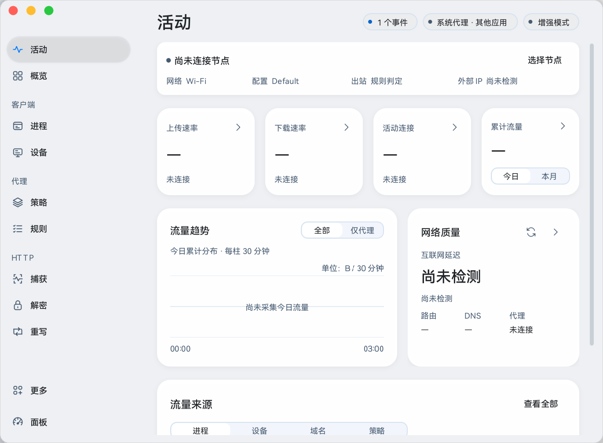
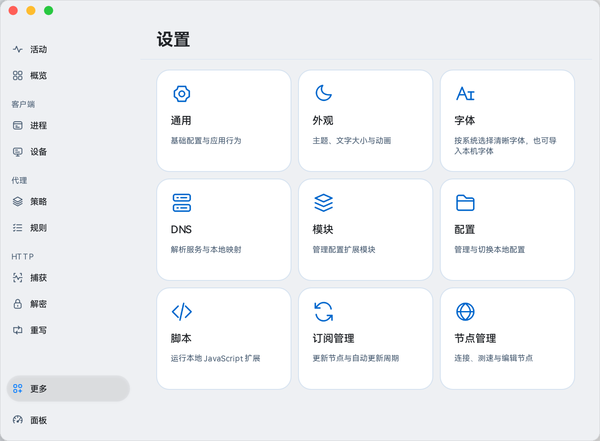
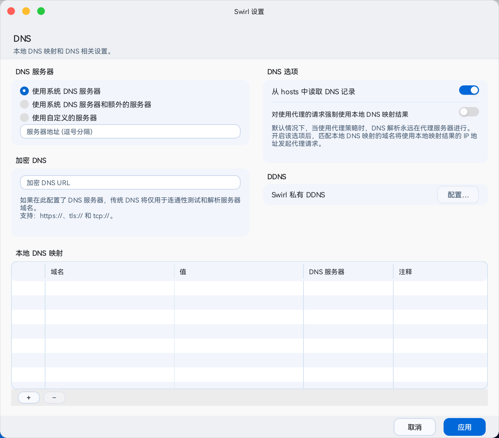

# Swirl

<picture><source media="(prefers-color-scheme: dark)" srcset="src/Swirl.Quick/assets/icons/swirl_knot_dark.svg"></picture>

Swirl 是面向 Windows 的网络工具，使用 **C++23、Qt 6 Quick/QML** 构建桌面界面，提供代理连接、网络活动监控与 HTTP 调试。基础 TCP 代理由 Swirl 原生引擎处理，复杂协议、规则分流与 TUN 等能力由固定版本 Mihomo 兼容引擎执行。

> **当前状态：Windows 开发测试版。** 当前程序版本为 `1.0.0-test-6A+<源码提交>`，尚未发布正式版。功能是否可用以实际运行状态为准；协议可导入、配置可保存，不代表所有远程节点、专用 LAN 或高级功能已经验证。

主窗口采用 10pt 精确轮廓，同级卡片共用圆角规范。Windows Acrylic 与该自定义轮廓组合会出现方角，因此精确轮廓窗口使用现有中性回退材质及兼容阴影。见 [实现说明](docs/SETTINGS_CARD_REPAIR.md) 和 [转场、输入及资源实测](docs/SETTINGS_TRANSFER_VALIDATION.md)。

[](https://github.com/SOLHK/Swirl/actions/workflows/build-qt-quick-ui.yml) · [测试版安装程序](https://github.com/SOLHK/Swirl/releases) · [测试分支](https://github.com/SOLHK/Swirl/tree/test)

## 主要功能与边界

| 功能 | 当前实现 |
| --- | --- |
| 代理连接 | 统一 `ProxyEngine` 接口，网络引擎运行在独立线程。Swirl 原生支持 DIRECT、HTTP CONNECT、SOCKS5 与基础 Trojan TLS/TCP；复杂传输与未覆盖能力交给 Mihomo，失败不会静默绕过节点直连。 |
| 节点与订阅 | 手动管理节点、订阅导入与定时刷新；节点凭据及订阅地址由当前 Windows 用户的 DPAPI 加密保存。多种格式经过归一化，未知选项保留并明确提示。具体节点能否联网仍需测试。 |
| 路由与 DNS | 规则、全局、直连模式，自定义 DNS、规则与策略组。默认 OpenAI 相关域名使用同一代理选择器；用户自定义覆盖需结合诊断核查。 |
| Windows 系统代理 | 通过明确操作启用当前用户的系统代理。接管前保存恢复快照，正常退出或守护检测到进程退出时按归属恢复；外部软件改动后不会覆盖其设置。 |
| 网络活动 | 从真实引擎采集连接、进程、流量与延迟，支持活动、节点、连接和进程详情。没有采样或未连接时显示空状态。设备信息依赖实际网络采样，不代表已完成所有 LAN 场景验收。 |
| HTTP 工具 | 本机 HTTP 捕获、CONNECT 隧道、按主机名解密的 HTTPS HTTP/1.1 与 HTTP/2，以及 HAR 导出、URL/Header/Body 重写、静态 Mock、TCP 端口转发。HTTPS 内容处理需要配置 CA 并成功解密。 |
| 设置与本地扩展 | 主题、字体、减少动态效果、配置草稿、本地 JavaScript 手动执行与配置模块覆盖。设置卡片与详情保留当前交互状态；草稿入口不等于对应网络服务已实现。 |
| TUN、LAN 与网关 | 已有 Mihomo TUN、局域网认证代理、计费网络进程白名单及自研 DHCP/网关控制路径。TUN/网关需要相应权限，专用 LAN 与真实设备互通仍需单独验证。 |

长连接保护包括独立的节点测速配置、订阅刷新延后应用，以及控制接口异常时保留仍可转发的连接。这些机制有隔离回归测试；**不能据此保证所有 Codex、WebSocket 或 SSE 会话已通过真实远端验收**。主动断开、退出程序或需要重新连接的配置变更仍会关闭对应连接。

尚未完成的能力包括原生 UDP Relay、自动屏蔽 QUIC、HTTP/3 解密、完整断点暂停/编辑、WebSocket 帧检查及 HTTP 脚本挂钩。WireGuard 等通过兼容引擎提供配置路径，完整私有组网互通未全面验证；不兼容 Surge Ponte 私有协议。

详见 [原生与兼容引擎边界](docs/PR12_NATIVE_ACCEPTANCE.md)、[HTTP 捕获说明](src/Swirl.Quick/CAPTURE.md) 和 [本地扩展格式](docs/LOCAL_EXTENSIONS.md)。这些文档中的历史测试记录保留其原始提交和验证范围。

## 最新界面截图

以下截图来自本次修改后实际构建并运行的 Windows 程序，保留完整应用窗口。截图处于未连接状态，没有填充虚构的节点、流量或性能数据。截图记录界面外观，不能替代网络功能验证。

### 网络活动



### 设置首页



### 设置详情



[截图来源与历史索引](docs/screenshots/README.md)

## 安装与使用

[Releases](https://github.com/SOLHK/Swirl/releases) 中的预发布版本提供 Windows x64 `Swirl-Setup.exe`。下载安装前核对对应提交与构建结果，并退出已运行的旧版 Swirl。当前安装程序未签名。

添加或导入节点后，先检查节点能力说明并完成实际联网测试，再按需要启用系统代理。TUN、LAN、网关和证书信任需要各自明确的启用操作；保存草稿不会自动开启这些服务。不同应用读取系统代理或环境变量的方式不同，应通过实际连接路径诊断确认代理是否生效。

本机验收发现，仅切换 Windows 系统代理时，部分 Codex 后台请求仍直连；新建 CLI 进程显式继承代理变量后可完成请求及 135 秒工具等待后的输出，期间仍有一次服务端 HTTP 503。可先用 PowerShell 7 执行 `./tools/Start-CodexWithSystemProxy.ps1 -CheckOnly`，核对当前显式回环代理与桌面程序路径，再自行完全退出 Codex 桌面并运行该脚本启动。它只为新进程及其继承环境的后代设置代理变量，不修改持久环境或 Codex 配置；发现已有桌面进程会拒绝启动。完整桌面重新启动后的所有通道尚未验收，详见 [真实测试结果与启动方法](docs/NETWORK_RELIABILITY_6A.md#仅为新-codex-桌面进程设置代理)。

## 开发与构建

需要 Windows x64、Qt 6.9+、CMake 3.25+ 与匹配 Qt 的 C++23 编译器；当前验证环境为 Qt 6.10.3。可使用 MSVC 2022 或 MinGW 13.1，不能混用两种工具链的 Qt 库。制作安装程序另需 NSIS。

```powershell
cmake -S src/Swirl.Quick -B build/quick -G Ninja -DCMAKE_BUILD_TYPE=Release -DCMAKE_PREFIX_PATH=C:/Qt/6.10.3/mingw_64 -DSWIRL_BUILD_UI_TESTS=ON
cmake --build build/quick --parallel 6
./scripts/stage-mihomo.ps1 -Destination build/quick
ctest --test-dir build/quick -E "^swirl-system-proxy-recovery$" --output-on-failure
```

系统代理恢复测试会临时修改当前用户的 Windows 代理，应在专用环境单独执行。常规网络回归使用隔离的本机服务，真实远程节点、Codex 登录及长时间输出、TUN 和专用 LAN 验收需另行记录。生产包必须重新配置 `SWIRL_BUILD_UI_TESTS=OFF`，不携带测试驱动。完整步骤见 [Windows 构建说明](src/Swirl.Quick/BUILDING.md)。

[Windows Qt CI](https://github.com/SOLHK/Swirl/actions/workflows/build-qt-quick-ui.yml) 对 `main`、`test` 的推送及相关 PR 执行编译、回归、截图与打包；只有 `test` 分支推送自动产生测试版预发布安装程序。CI 生成的离屏截图是渲染检查，不代表真实网络或物理显示性能。构建状态请以对应提交的 GitHub Actions 结果为准。

## 仓库结构

| 位置 | 内容 |
| --- | --- |
| [`src/Swirl.Quick/`](src/Swirl.Quick/) | C++23、Qt Quick/QML、代理引擎、HTTP 工具、测试与 NSIS 打包 |
| [`scripts/`](scripts/) | Windows 构建、核心暂存及分支保护辅助工具 |
| [`tools/`](tools/) | 连接路径诊断与本机取证工具 |
| [`docs/`](docs/) | 架构、功能边界、截图与验收记录 |
| [`.github/workflows/`](.github/workflows/) | Windows Qt 构建、源码检查及正式分支保护 |

`test` 用于开发验证，`main` 更新需仓库所有者授权并遵守分支保护。更新主分支不代表发布正式版。旧 C# / WPF 代码保留在 [备份分支](https://github.com/SOLHK/Swirl/tree/backup/pre-qt-only-20261012) 与 Git 历史中。
