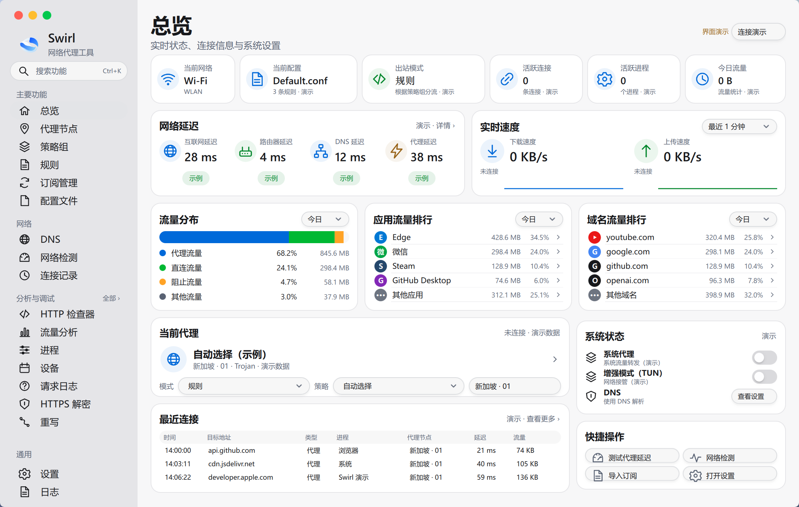
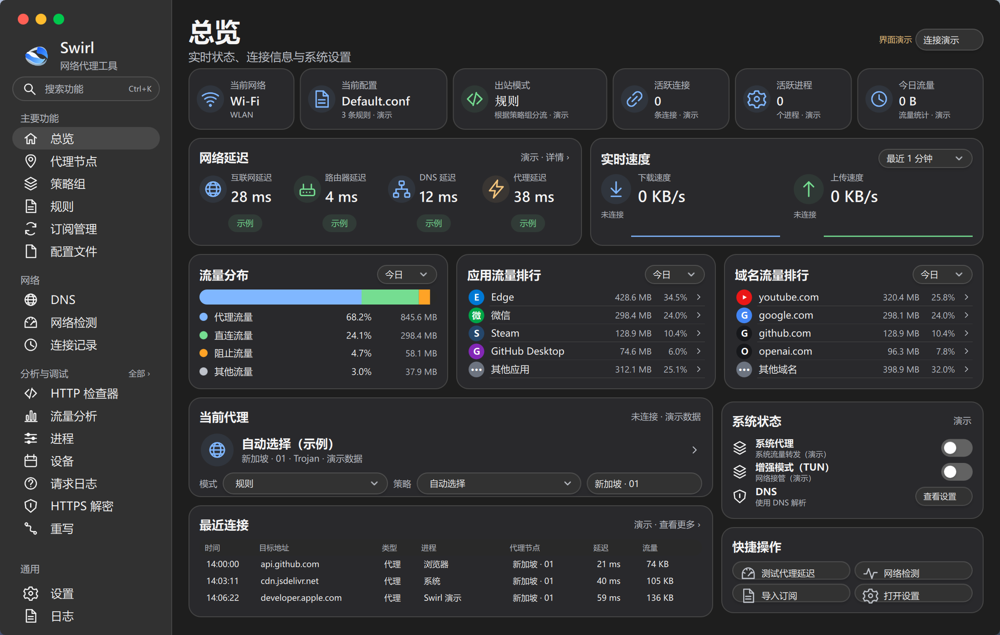
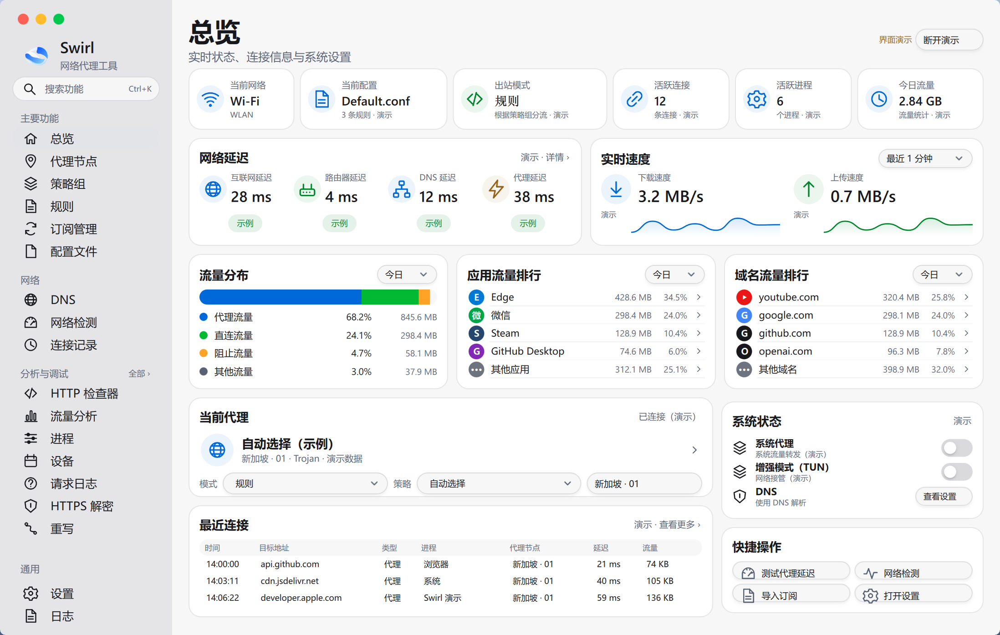

# Swirl

**Swirl** 是面向 Windows 的专业网络工具项目，目标是将代理与规则管理、HTTP 调试、连接分析等能力整合在简洁、统一的桌面界面中。当前主力界面采用 **C++23 + Qt 6 Quick/QML**，设计语言参考 macOS 应用的克制布局与系统材质，但运行平台为 Windows。

> **🧪 当前展示：Swirl 1.0 UI 测试版（`1.0.0-preview`）**，对应 [`test` 分支](https://github.com/SOLHK/Swirl/tree/test) 的 Qt UI。此版本不是已完成的代理客户端，也不是正式发布版。Qt 的代理连接、规则执行、TUN、真实流量与延迟采集等仍为演示或待接入功能。

 · [下载 Windows 测试版 EXE](https://github.com/SOLHK/Swirl/releases/tag/swirl-qt-test-0fb2ad8) · [查看测试分支](https://github.com/SOLHK/Swirl/tree/test) · [验证报告](docs/UI_1_0_VALIDATION.md)

## 最新测试版截图

以下截图来自 `test` 的 [`0fb2ad8`](https://github.com/SOLHK/Swirl/commit/0fb2ad8b2779ae0f621b8dd4f3f69c12eaf95585)：实际安装后的 Windows EXE、真实前景合成画面，**不是设计效果图**。界面内的示例节点、流量排行、延迟和演示连接状态不代表真实代理数据。

### 浅色总览

### 暗色界面与连接演示

| 暗色界面 | 连接演示（示例数据） |
| --- | --- |
|  |  |

[全部截图与历史图说明](docs/screenshots/README.md) · [Windows 原生背景与 UI 验收](docs/UI_1_0_VALIDATION.md)

## Qt 1.0 测试版已实现的内容

- **统一的 Windows 原生窗口**：中性灰白侧栏、中性浅色内容区、柔和圆角及共享视觉令牌。支持浅色/暗色主题、窗口控制、缩放布局与滚动；符合条件时由 Windows DWM 提供原生 Desktop Acrylic，条件不满足时使用不透明回退。
- **网络总览和专业工具入口**：六项摘要、延迟与速度、流量分布、应用与域名排行、代理和连接、系统状态及快捷操作。多数网络数据明确为演示。
- **真实的独立 HTTP 会话抓包**：用户主动开启本机显式代理后，可以检查 HTTP 请求/响应、记录 CONNECT 隧道信息并导出 HAR。不会自动接管系统代理，也**不解密 HTTPS 正文**。
- **模块与草稿**：56 个功能入口、32 个独立配置草稿页；支持本地草稿保存及 JSON 导入/导出。页面与草稿并不等于对应网络功能已经运行。
- **Windows 测试安装包**：NSIS 安装程序 `Swirl-Setup.exe`，支持覆盖安装与保留用户数据；安装时应先退出已运行的 Swirl。测试版尚未代码签名。

## 尚未完成的功能

| 领域 | 当前 Qt 测试版状态 |
| --- | --- |
| Mihomo 代理连接、节点切换、策略和订阅 | Qt 页面主要为演示，尚未连接旧后端 |
| Windows 系统代理、TUN、真实连接与流量统计 | 尚未接入 Qt 网络核心，界面上的对应数值或开关为演示 |
| DNS 分流、规则、流量分析、脚本及 HTTP 改写 | 存在界面或草稿，不能视为已可实际执行 |
| HTTPS 解密、WebSocket 分析、PCAP 抓包 | Qt 抓包尚不具备这些完整能力 |
| HTTP 显式代理抓包、CONNECT 记录与 HAR 导出 | **已实现**；需要手动配置发起请求的测试应用 |

原有 **WPF/.NET + Mihomo** 网络业务源码仍保留在仓库，但未与当前 Qt 前端完成集成。后续计划通过独立的代理引擎抽象层逐步接入，不会把“已有代码”当作“Qt 安装包当前已能使用”。对照细节见 [Surge 功能现状](docs/SURGE_FEATURE_MATRIX.md)、[模块覆盖表](docs/UI_MODULE_COVERAGE.md) 和 [抓包说明](src/Swirl.Quick/CAPTURE.md)。

## 下载与安装测试版

1. 打开 [Swirl 1.0 UI 测试版发布页（对应已验证界面）](https://github.com/SOLHK/Swirl/releases/tag/swirl-qt-test-0fb2ad8)，直接下载 **`Swirl-Setup.exe`**。也可查看 [全部测试发布](https://github.com/SOLHK/Swirl/releases)。
2. 在 Windows x64 上退出原有 Swirl 后运行安装程序。该安装包尚未签名；仅在信任源码及发布者的前提下运行。
3. 安装后可浏览 Qt UI，并在抓包页按说明测试真实 HTTP 会话；**不要将界面上的“连接”演示按钮当作实际联网代理**。

当前基准提交 `0fb2ad8` 的 [Qt Quick Preview CI](https://github.com/SOLHK/Swirl/actions/runs/38161690968) 和 [Windows CI](https://github.com/SOLHK/Swirl/actions/runs/38161690929) 均已通过。Windows 实机验收包含 39 项输入检查、32 项 HTTP 抓包检查、41 项原生窗口检查、61 页加载和 28 项隔离安装/更新/卸载检查；跨系统版本、多物理显示器及长期压力等范围**尚未全部验证**。详见 [UI 1.0 验收报告](docs/UI_1_0_VALIDATION.md)。

## 项目结构与开发流程

| 目录 | 用途 |
| --- | --- |
| [`src/Swirl.Quick/`](src/Swirl.Quick/) | C++23 / Qt 6 Quick/QML 现行界面、抓包服务与 Windows 安装构建 |
| [`AdShield/`](AdShield/) | 保留的原 WPF/.NET 网络业务代码，不代表当前 Qt 已接入 |
| [`docs/`](docs/) | 验收结果、模块覆盖、功能边界及截图记录 |
| [`scripts/`](scripts/) | Windows 构建及其他开发脚本 |

开发与验收先在 [`test`](https://github.com/SOLHK/Swirl/tree/test) 进行，未经项目所有者明确批准，不将测试代码合并至 [`main`](https://github.com/SOLHK/Swirl/tree/main)，也不把测试安装包标记为正式版本。构建步骤见 [Qt Windows 构建说明](src/Swirl.Quick/BUILDING.md)，分支与发布要求见 [发布流程](docs/RELEASE_PROCESS.md)。

## 历史版本记录

早期 WPF/.NET 0.6.x–0.7.1 的说明、功能边界和旧版截图保存在 [历史版本文档](docs/LEGACY_WPF.md)。这些内容用于追溯，不是当前 Qt 1.0 测试版的功能承诺。
