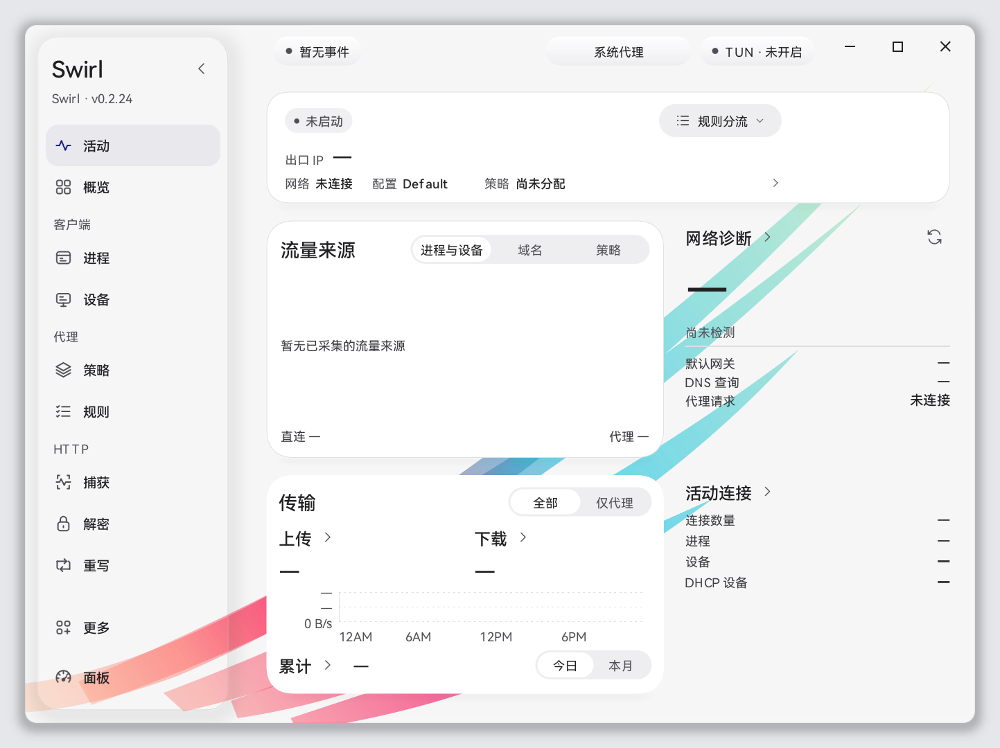

# Swirl

**Rust 自研内核 · Qt Quick 桌面界面 · APEC 羽翼与清透悬浮玻璃**

<picture><source media="(prefers-color-scheme: dark)" srcset="src/Swirl.Quick/assets/icons/swirl_knot_dark.svg"></picture>

Swirl 是面向 Windows 的网络工具，桌面界面使用 **C++23、Qt 6 Quick/QML**，**自研代理内核使用 Rust**，源码位于 [`core/`](core/)。Rust 在进程内负责协议、TCP/UDP、DNS、路由和运行时；Qt 提供界面、导入、操作系统集成及 HTTP 工具。Clash/Mihomo YAML、sing-box 和 Xray/V2Ray JSON 等配置格式仍可导入，具体参数能否执行由 Rust 内核的能力校验决定。

> **当前状态：Windows x64 开发测试版。** 版本见 [`PRODUCT_VERSION.txt`](src/Swirl.Quick/PRODUCT_VERSION.txt)。产品只运行 Swirl Rust Core，没有外部代理内核的调用、下载或回退路径。协议可导入、配置可保存，不代表所有远程节点、专用 LAN 或高级功能已经验证。

[](https://github.com/SOLHK/Swirl/actions/workflows/build-qt-quick-ui.yml) · [下载测试版](https://github.com/SOLHK/Swirl/releases) · [测试分支](https://github.com/SOLHK/Swirl/tree/test) · [Windows 构建说明](src/Swirl.Quick/BUILDING.md)

<picture>
  <source media="(prefers-color-scheme: dark)" srcset="docs/screenshots/apec-activity-dark.png">
  
</picture>

[浅色界面](docs/screenshots/apec-activity-light.png) · [深色界面](docs/screenshots/apec-activity-dark.png) · [截图来源与历史索引](docs/screenshots/README.md)

截图来自同一当前构建的真实 Windows 程序，使用隔离空配置，未连接代理。未添加演示节点、出口 IP、延迟或流量；运行中的祥云结也不会出现在未连接状态。截图展示界面，不代表真实远端网络或私有订阅已通过验收。

## 界面与交互

- **清透悬浮侧栏**：APEC 羽翼在面板内外保持连续，主体不叠加乳白填充或背景模糊，通过细描边、边缘高光和轻微外阴影呈现悬浮轮廓。
- **连续圆角与分层信息**：卡片按尺寸适配曲率；顶部状态卡汇集运行状态、当前策略及出口信息，缺少真实数据时保留空状态。
- **独立模式胶囊**：顶部当前模式可展开为「规则分流」「全局代理」「直连模式」，选中项保持完整圆角，切换后自动收起。
- **五色丝绳祥云结**：接管系统代理时，五根带细密丝线纹理的圆头绳子从状态卡左侧同时伸出、编入右侧祥云结；关闭时按顺序向左撤回，中途反向切换可延续当前位置。
- **保留跟手反馈**：悬停、按压、释放、键盘焦点和页面过渡保持连贯，并支持减少动态效果。启动呈现和增量列表同步经过局部性能优化；实际帧率仍取决于设备与场景。

## 官方社区

| 入口 | 用途 |
| --- | --- |
| [Swirl官方频道](https://t.me/SwirlUpdates) | 版本更新与官方公告 |
| [Swirl交流群](https://t.me/SwirlHQ) | 使用交流与经验分享 |

Bug 和功能请求请提交到 [GitHub Issues](https://github.com/SOLHK/Swirl/issues)，便于正式跟踪；社区讨论不替代 Issue 记录。

## 主要功能与边界

| 功能 | 当前实现 |
| --- | --- |
| 代理连接 | `ThreadedEngine` 通过配套 Rust DLL 执行原生转发。仅支持经过校验的协议、传输与安全参数组合；不支持的能力明确拒绝，不切换到外部内核或绕过节点直连。 |
| 节点与订阅 | 手动管理节点、订阅导入与定时刷新；节点凭据及订阅地址由当前 Windows 用户的 DPAPI 加密保存。多种格式经过归一化，未知选项保留并明确提示。具体节点能否联网仍需测试。 |
| 路由与 DNS | 规则、全局、直连模式，自定义 DNS、规则与策略组。默认 OpenAI 相关域名使用同一代理选择器；用户自定义覆盖需结合诊断核查。 |
| Windows 系统代理 | 通过明确操作启用当前用户的系统代理。接管前保存恢复快照，正常退出或守护检测到进程退出时按归属恢复；外部软件改动后不会覆盖其设置。 |
| 网络活动 | 从真实引擎采集连接、进程、流量与延迟，支持活动、节点、连接和进程详情。没有采样或未连接时显示空状态。设备信息依赖实际网络采样，不代表已完成所有 LAN 场景验收。 |
| HTTP 工具 | 本机 HTTP 捕获、CONNECT 隧道、按主机名解密的 HTTPS HTTP/1.1 与 HTTP/2，以及 HAR 导出、URL/Header/Body 重写、静态 Mock、TCP 端口转发。HTTPS 内容处理需要配置 CA 并成功解密。 |
| 设置与本地扩展 | 主题、字体、减少动态效果、配置草稿、本地 JavaScript 手动执行与配置模块覆盖。设置卡片与详情保留当前交互状态；草稿入口不等于对应网络服务已实现。 |
| TUN、LAN 与网关 | 当前 Rust 产品不提供已验收的 TUN、LAN 代理或网关数据平面。保留的设置、草稿及归属恢复代码不构成能力通过；不支持的启用操作会拒绝。 |

配置更新经过验证后发布到 Rust 运行时，既有流与新连接的应用范围通过回执区分。节点测试和订阅资料操作不应改变当前出口。**受控回归不能证明所有 Codex、WebSocket 或 SSE 会话已通过真实远端验收**；主动断开、退出程序或明确要求重连的操作仍会关闭对应连接。

HTTP/3 解密、完整断点暂停/编辑、WebSocket 帧检查、HTTP 脚本挂钩及完整私有组网能力尚未获得产品验收。不支持的 WireGuard、TUN 或其他源配置不会交给兼容内核执行，也不会静默改写为另一条网络路径。

详见 [Rust 内核与当前边界](core/README.md)、[HTTP 捕获说明](src/Swirl.Quick/CAPTURE.md) 和 [本地扩展格式](docs/LOCAL_EXTENSIONS.md)。[R1 运行时迁移记录](docs/R1_RUNTIME_CAPABILITIES.md)及其他日期较早的文档保留其原始提交和验证范围，不能作为当前提交的通过证据。旧界面截图保留在[历史索引](docs/screenshots/README.md#历史记录)中。

## 安装与使用

[Releases](https://github.com/SOLHK/Swirl/releases) 中的预发布版本提供 Windows x64 `Swirl-Setup.exe`。下载安装前核对对应提交与构建结果，并退出已运行的旧版 Swirl。当前安装程序未签名。

添加或导入节点后，先检查节点能力说明并完成实际联网测试，再在活动页按需要启用系统代理。TUN、LAN 与网关设置不能因保存草稿就视为可用；HTTPS 解密的证书信任需要明确授权。不同应用读取系统代理或环境变量的方式不同，应通过实际连接路径诊断确认代理是否生效。

安装包包含独立 `SwirlCodexLauncher.exe`（开始菜单“通过 Swirl 启动 Codex”），仅为新进程设置代理环境，不修改持久设置；已有桌面进程会被拒绝。使用前先连接 Swirl 并启用系统代理，再自行完全退出 Codex，通过启动器打开。历史 CLI 请求、长时间输出及 OAuth 诊断分别保存在 [登录诊断记录](docs/CODEX_LOGIN_WINDOWS.md) 和 [网络可靠性记录](docs/NETWORK_RELIABILITY_6A.md#仅为新-codex-桌面进程设置代理)。这些记录中的 HTTP 状态和成功请求仅属于原始测试来源，不代表当前 Codex Desktop 登录、工作区及长连接已经验收。

## 开发与构建

需要 Windows x64、Qt 6.12.0、CMake 3.25+、Cargo 和匹配 Qt 的 C++23 编译器。当前 UI 构建使用 Qt 6.12.0 的 GCC 15.1.0 MinGW kit，配对 Rust `x86_64-pc-windows-gnu`；MSVC kit 配对 `x86_64-pc-windows-msvc`。不能混用 Qt 库、编译器或另一构建目录的 Rust DLL。制作安装程序另需 NSIS。

```powershell
# 在匹配 Qt kit 的编译环境中运行；Cargo 必须在 PATH 中。
cmake -S src/Swirl.Quick -B D:/Codex/build/swirl-qa -G Ninja -DCMAKE_BUILD_TYPE=Release -DCMAKE_PREFIX_PATH=D:/Codex/toolchains/Qt-6.12.0/6.12.0/mingw_64 -DSWIRL_BUILD_UI_TESTS=ON
cmake --build D:/Codex/build/swirl-qa --parallel 4
ctest --test-dir D:/Codex/build/swirl-qa -E "^swirl-system-proxy-recovery$" --output-on-failure
```

系统代理恢复测试需要可丢弃的独立环境，不能在用户正在使用的代理、TUN、路由或 DNS 上执行设置变更。其余网络回归使用隔离的本机服务；真实远程节点、Codex 登录及长时间输出、TUN 和专用 LAN 验收需另行记录。生产构建使用独立目录，并关闭 `SWIRL_BUILD_UI_TESTS` 与 `SWIRL_BUILD_CORE_TESTS`，不携带测试入口。完整步骤见 [Windows 构建说明](src/Swirl.Quick/BUILDING.md)。

[Windows Qt CI](https://github.com/SOLHK/Swirl/actions/workflows/build-qt-quick-ui.yml) 执行编译、关键回归、截图与打包，触发分支和发布条件以当前工作流为准。CI 生成的离屏截图是渲染检查，不代表真实网络或物理显示性能。构建状态请以对应提交的 GitHub Actions 结果为准。

## 架构与源码

| 模块 | 单一现行实现 |
| --- | --- |
| UI / 页面 / 动效 | `src/Swirl.Quick/qml/`，APEC V3 Qt Quick/QML |
| Windows 应用、字体与组件 | `src/Swirl.Quick/main.cpp`、`app/` |
| 控制层与持久化 | `src/Swirl.Quick/engine/`（Qt facade、DPAPI 节点存储、订阅） |
| 唯一网络运行时 | `core/crates/`：`swirl-api` / `swirl-core` / `swirl-protocol` / `swirl-transport` / `swirl-dns` / `swirl-routing` 等 |
| 与内核的唯一连接 | `src/Swirl.Quick/engine/RustCoreLibrary.*`、`RustCoreEngine.*`、`cmake/SwirlRustCore.cmake` |
| 本地抓包及 Windows 集成 | `src/Swirl.Quick/network/`、`app/`、`tools/` |
| 发布程序 | `scripts/Stage-WindowsRustProduct.ps1`、`scripts/Build-WindowsRustProductInstaller.ps1`、`src/Swirl.Quick/packaging/Swirl.nsi` |

Rust 库必须与 EXE 使用同一源码修订和构建 ID；安装包会检查真实 DLL 及 manifest，并拒绝 Mihomo、Clash、Xray、sing-box 等外部代理可执行文件。订阅源中的 YAML、URI、JSON、配置名称属于**输入数据**，不能误删，否则将破坏导入兼容性。具体架构见 [ARCHITECTURE](docs/ARCHITECTURE.md)、[Rust Core](core/README.md) 和 [构建指南](src/Swirl.Quick/BUILDING.md)。

APEC 设计资料：[基线](docs/SWIRL_V3_APEC_BASELINE.md) · [视觉设计](docs/SWIRL_V3_APEC_DESIGN.md) · [动效](docs/APEC_MOTION_FOUNDATION.md) · [性能](docs/APEC_PERFORMANCE_INTEGRATION.md)。设计提案与历史截图有各自的日期；当前外观以本页新截图和同提交程序为准，历史资料不构成新版本的验收结果。

## 仓库结构

| 位置 | 内容 |
| --- | --- |
| [`src/Swirl.Quick/`](src/Swirl.Quick/) | C++23、Qt Quick/QML、代理引擎、HTTP 工具、测试与 NSIS 打包 |
| [`scripts/`](scripts/) | Windows 构建、配套 Rust DLL 校验、打包与安装维护 |
| [`tools/`](tools/) | 连接路径诊断与本机取证工具 |
| [`docs/`](docs/) | 架构、功能边界、截图与验收记录 |
| [`.github/workflows/`](.github/workflows/) | Windows Qt 构建、源码检查及正式分支保护 |

`test` 用于开发验证，`main` 更新需仓库所有者授权并遵守分支保护。更新主分支不代表发布正式版。旧 C# / WPF 代码保留在 [备份分支](https://github.com/SOLHK/Swirl/tree/backup/pre-qt-only-20261012) 与 Git 历史中。
