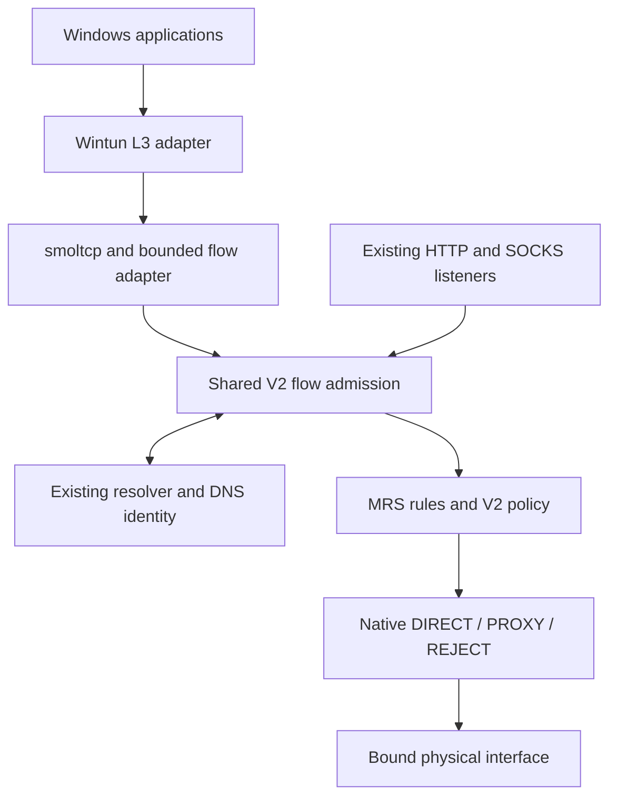

# Native Windows TUN: implementation, evidence and remaining acceptance

## Delivery status

The Rust packet backend, shared Core ingress, DNS identity adapter, Windows
network controller and versioned helper control are implemented on an isolated
branch. The final local Linux workspace run passed **870 tests across 45 test
targets, with zero failures, ignored tests or filtered tests**. This establishes
portable behavior and real loopback networking; it does not establish Windows
11 Wintun acceptance. Stages D and E remain unaccepted on a real Windows machine.

The evidence snapshot below covers the implementation through
`ffea437c612de0e15938f3576f5c0a89a17fadcd` and the final locked dependencies.
[Draft PR #42](https://github.com/SOLHK/Swirl/pull/42) carries the live exact-head
CI checks. The initial CI attempts found Windows journal access, native UDP
termination/publication and PowerShell 5.1 null-serialization defects; these
were fixed without changing the original assertions. The
workflow now also executes an explicitly scoped real Wintun smoke in a disposable
Windows runner. Only its successful logged result establishes that limited driver
test; the presence of the test or a Linux pass does not establish Windows success.

Companion documents:

- [Native TUN control API](NATIVE_TUN_CONTROL_API.md): JSON schema, Rust entry
  points, helper invocation, error handling and later Qt integration.
- [Dependency and security review](NATIVE_TUN_DEPENDENCIES.md): exact versions,
  licenses, driver hashes, notices, RustSec findings and their fixes.
- [Disposable Windows driver smoke](NATIVE_TUN_SMOKE.md): exact scope, explicit
  opt-in, restoration assertions and limits.
- [Machine-readable local evidence](native-tun-evidence/linux-ffea437.json) and
  [raw full workspace log](native-tun-evidence/linux-ffea437.log).
- [Packet-stack boundary](../crates/swirl-tun/README.md): supported packet
  behavior, configuration limits and protocol exclusions.

## Baseline and parallel-development isolation

Delivery branch: `work/native-tun-windows-20261030-isolated`.
Audited baseline: `4ad8a23b7fd59f0f8c09f1e3547548b16baaf4e9` (`main`).
At checkout, `test` was `9d35542e092474056f6c154af351dbd84bf7fff4`,
one merge commit behind main. The latest `work/swirl-0219-clear-glass-20261029`
head (`6941ea37d5fe8dac128f38eca273d72aadbee1e0`) was already an ancestor
of main. These are the original audit observations, not claims about the present
heads of those branches. At PR targeting time, both commits had the identical
source tree `d20f5f9565c2fb839bc3a56409818e7a43281c40`. The feature PR targets
`test`, preserving the separate owner-approved `test → main` release gate.

The requested `work/native-tun-windows-20261030` remote branch was absent at the
initial inspection. During development it received continuing commits from an
external Cursor Agent. To preserve that work and the user's isolation constraint,
this implementation moved to the `-isolated` branch from the audited baseline.
The external branch was neither overwritten nor merged into this implementation;
no force-push or change to `main` or `test` was performed for this task.

This work does not change activity-page QML, cards, animation, fonts, themes,
icons or other visual resources. The existing Qt TUN switch remains disabled.
Delivery is by reviewable branch/PR, without automatic merging or a release.
The older promotion instructions in `AGENTS.md` concern a different candidate.

## Stage commits

| Stage | Commit | Delivered scope and acceptance boundary |
| --- | --- | --- |
| A | [`f8b5336d3fbe5160ec8eee40da5faac50a0514f7`](https://github.com/SOLHK/Swirl/commit/f8b5336d3fbe5160ec8eee40da5faac50a0514f7) | Actual-source architecture audit and isolation boundaries. At this commit, no TUN data-plane tests had run. |
| Dependency security | [`c31c05f0d745ae4cf04470598fa070767c77974e`](https://github.com/SOLHK/Swirl/commit/c31c05f0d745ae4cf04470598fa070767c77974e) | Fix the applicable locked TLS, ML-KEM dependency and zstd advisories; preserve checks and notices. |
| B | [`1720ba3d0d7f8e18c5754c22b34022f84a1c5215`](https://github.com/SOLHK/Swirl/commit/1720ba3d0d7f8e18c5754c22b34022f84a1c5215) | Bounded dual-stack smoltcp adapter, Wintun boundary, shared native Core entry and supporting DNS/network primitives. Portable tests establish packet/stream behavior; real Wintun is unverified. |
| C | [`f9fcd905de6dd04c55f3b7a67037be313d813153`](https://github.com/SOLHK/Swirl/commit/f9fcd905de6dd04c55f3b7a67037be313d813153) | Join L3 TCP/UDP and intercepted DNS directly to V2; full packet-to-Core loopback tests and explicit rejection. |
| D | [`0a4609654913ab27036bf5a09fb05c5dc4af7c57`](https://github.com/SOLHK/Swirl/commit/0a4609654913ab27036bf5a09fb05c5dc4af7c57) | Owned Windows lifecycle, persistent egress guard, helper supervision and versioned control. Windows network-switch, crash and restoration acceptance is still pending. |

Follow-up commits retain the evidence of the first CI failures:

- [`3c93c9583c48fc28dab0921ea6ef99f2c9e79496`](https://github.com/SOLHK/Swirl/commit/3c93c9583c48fc28dab0921ea6ef99f2c9e79496): pass Windows notice paths through argv, preserving exact inventory and byte checks.
- [`dc293997178a370326af822da2d515aa36964ba5`](https://github.com/SOLHK/Swirl/commit/dc293997178a370326af822da2d515aa36964ba5): read/write, exclusively locked Fake-IP journals with explicit EOF seeking after torn-tail repair.
- [`456d5c2b95e947d7ca4ffd2f57a1ced454be3c40`](https://github.com/SOLHK/Swirl/commit/456d5c2b95e947d7ca4ffd2f57a1ced454be3c40): one native UDP terminal cause even when channels close first or a runtime drops an unpolled task; correct dedicated loopback UDP binding.
- [`66f97ea87269322bf7c5341443e78bf59c2733ca`](https://github.com/SOLHK/Swirl/commit/66f97ea87269322bf7c5341443e78bf59c2733ca): bounded worker responses and final supervisor reports, with four fault-ordering tests.
- [`7d5c16623c8dfa7f1016b5d27ed605635b80f681`](https://github.com/SOLHK/Swirl/commit/7d5c16623c8dfa7f1016b5d27ed605635b80f681): explicit disposable-VM real Wintun TCP/UDP/DNS smoke and CI execution.
- [`7643a3abf4163aea0e1dd54c2af42c7b12d03455`](https://github.com/SOLHK/Swirl/commit/7643a3abf4163aea0e1dd54c2af42c7b12d03455): account successful native UDP bytes before waking senders/receivers, with three deterministic publication-boundary regressions.
- [`ffea437c612de0e15938f3576f5c0a89a17fadcd`](https://github.com/SOLHK/Swirl/commit/ffea437c612de0e15938f3576f5c0a89a17fadcd): emit explicit absent-resource JSON on Windows PowerShell 5.1, assign suspended network commands to kill-on-close jobs before execution, and bound stdin with the command deadline.

The original UDP-stop assertion reproduced on local iteration 25; after the
root-cause correction it passed 500 consecutive repetitions, in addition to
four deterministic close-order regressions. See the [before-fix failure](native-tun-evidence/udp-close-before-fix.log)
and [500-repetition evidence](native-tun-evidence/udp-close-500-repetitions.log).

The later Linux CI exposed a separate counter-publication race: a received
1,200-byte UDP response could be visible before its download counter. The fix
reserves queue space, updates counters, then publishes the response; sends
likewise account before completion. Three deterministic wake-boundary tests
preserve the original exact byte assertions. Each original IPv4/IPv6 bridge
test also passed 500 repetitions, recorded in the
[1,000-result log](native-tun-evidence/udp-accounting-1000-repetitions.log).

The first real-driver run at `7d5c166` failed while reading a missing owned
resource, before DNS/TCP/UDP traffic. Windows PowerShell 5.1 returns no output
for `ConvertTo-Json $null`; the backend now emits literal JSON `null` and keeps
strict decoding. The original failed [driver job](https://github.com/SOLHK/Swirl/actions/runs/40942647862/job/123690486733)
remains part of the evidence. Windows compilation and packet/unit tests in that
job passed; they did not turn its driver failure into an acceptance pass.

Stage E has a documented control contract, portable regression evidence and a
dedicated CI workflow. Final Windows build results, real-machine acceptance,
privilege-separated product integration and installer sign-off remain gates,
not completed stages inferred from the presence of code.

## Stage A: findings at the audited baseline

The following table preserves the original findings at `4ad8a23`. The later
implementation addresses the missing pieces described here; the table is not a
current-feature checklist based on old documentation.

| Existing component | Source inspected | Baseline finding and reuse decision |
| --- | --- | --- |
| V2 runtime | `crates/swirl-core/src/v2.rs` | Immutable routing snapshots, prepare/activate/finish/rollback transactions, admission, node revocation and session records already existed. TCP ingress was coupled to HTTP/SOCKS negotiation; extract common flow admission and dialing. |
| Native TCP/UDP protocols | `crates/swirl-protocol/src/`, `swirl-core/src/socks5_udp.rs` | Native streams and datagram associations already existed. Reuse authentication, transports and association logic without a second proxy engine or a local SOCKS hop. |
| Rules and policy | `crates/swirl-routing/src/{v2,mrs}.rs`, `swirl-core/src/policy_v2.rs` | MRS domain/IP classification, service policies, rule tiers, fallback policy and explicit reject already existed. Select a route at flow admission. |
| DNS | `crates/swirl-dns/src/{lib,wire,dot,doh}.rs` | A/AAAA, bounded resolver concurrency, TTL/negative/failure caches, hosts, verified DoT/DoH and policy-selected encrypted query transport existed. An incoming DNS service and reliable IP-to-domain identity did not. |
| Platform | `crates/swirl-platform/src/lib.rs` | Only the system hosts-file path existed. Wintun, Windows network transactions and crash recovery needed implementation. |
| C ABI | `crates/swirl-api/src/{lib,control_v2}.rs`, `include/swirl_api.h` | A versioned bounded JSON command ABI existed; TUN capability was explicitly false. Extend the control boundary without changing the UI. |
| Qt bridge | `src/Swirl.Quick/engine/{RustCoreEngine,EngineController}.cpp` | Both explicitly rejected TUN. Keep the UI disabled until separate backend integration and acceptance. |
| Outbound network path | `swirl-protocol/src/dial.rs`, `swirl-transport/src/{udp,quic}.rs` | Outbound sockets followed system routing. Full capture required physical-interface binding for TCP, UDP, DNS and QUIC, beyond an exclusion for a single proxy-server IP. |

## Implemented data path and module boundaries



### Packet stack and common flow admission

[`swirl-tun`](../crates/swirl-tun/src/lib.rs) adapts L3 packets to correctly
sequenced TCP streams and UDP datagrams. smoltcp owns TCP state, retransmission,
windows, congestion control and checksums. Swirl supplies bounded admission,
packet queues, stream buffers, fragment adaptation and shutdown. Wintun packets
are never treated as a TCP byte stream. The stack handles SYN retransmission
without allocating another flow, separates equal ports at different addresses,
preserves half-close responses and resets an unforwarded rejected TCP flow.

[`FlowDispatcher`](../crates/swirl-core/src/native_flow.rs) exposes
`relay_tcp`, `open_udp`, `resolve_dns`, `runtime_handle` and
`prepare_native_tun`. Native and original proxy ingress share the V2 connection
budget, routing implementation, resolver, protocol dialing, session registry,
traffic counters and node-revocation barrier. Policy selection is retained for a
flow; packet forwarding does not repeatedly evaluate the full ruleset. Existing
sessions remain pinned to their selected outbound unless explicitly revoked.
A proxy error propagates without a retry through DIRECT.

UDP keeps a fixed destination and a bounded queue, preserves empty datagrams,
rejects undersized receive buffers explicitly and expires idle associations.
The bridge retains a failed/revoked UDP tuple for its idle interval rather than
silently creating a differently routed association for the next packet.
The [bridge](../crates/swirl-api/src/native_tun.rs) runs on the existing Core
Tokio runtime. Windows packet input uses one dedicated blocking reader; it does
not create another proxy runtime. Bounded resources are tested, but no measured
CPU, memory or throughput improvement is claimed.

### DNS identity and rule consistency

The packet bridge intercepts TCP/UDP port 53 and passes queries to
[`swirl-dns::tun`](../crates/swirl-dns/src/tun.rs), which validates them and asks
the existing policy-aware resolver for the requested name. It checks that the
requested IP family exists before returning a synthetic
A or AAAA address. An actual name error produces NXDOMAIN; empty results produce
NODATA; resolver, capacity and persistence failures produce SERVFAIL. It does not
invent successful DNS answers when the selected proxy or resolver fails.

Fake-IP identity is persisted before an answer is sent. IDs are never reassigned
to another name, including after restart; unknown or expired reserved addresses
fail closed. Responses have a 30-second TTL, mappings retain their identity for
300 seconds after allocation/refresh, and the Windows session allows 16,384
active names. The durable address sequence and 64 MiB journal have finite limits;
exhaustion fails instead of aliasing old addresses. Durable allocation runs on
bounded blocking jobs, outside Tokio's packet workers.

The Core recovers the canonical domain before applying domain/service policies.
Literal real-IP traffic still uses IP rules. A shared public IP is never guessed
to belong to a single domain. This reuses domestic/foreign classification,
global direct/proxy modes, custom rules, service policies, fallback policy and
REJECT from V2 rather than adding a TUN-specific rules engine.

The first native lease requires a quiescent Core and explicit validated encrypted
upstreams with numeric bootstrap endpoints. Active sessions and running probes
prevent that first acquisition. Prepare and activate both reject DNS downgrades
while any native lease is held, including transactions prepared before capture.
A lifecycle lease persists through bridge rebuilds so strict DNS admission cannot
briefly revert to plaintext/system lookup.

### Windows ownership, egress and recovery

The [Wintun boundary](../crates/swirl-platform/src/wintun_device.rs) verifies the
absolute local DLL path and pinned official architecture hash before loading;
it keeps a file lock and restricts dependent-DLL lookup. It creates a dedicated
adapter and does not adopt or overwrite an existing same-name adapter. Unsafe
Windows operations remain isolated in the platform boundary.

The [typed transaction](../crates/swirl-platform/src/network_transaction.rs)
records before/after values, adapter identity, ownership and write progress in
a durable journal. Recovery compares the current state with the state this
owner installed. Conflicting third-party changes are preserved and reported;
the journal remains available for recovery. The
[Windows backend](../crates/swirl-platform/src/windows_network.rs) configures
TUN addresses, MTU, DNS and split default routes, plus port-53 guards on the
known hardware adapters. It does not replace physical DNS settings or delete
physical default routes.

[`EgressLease`](../crates/swirl-transport/src/egress.rs) binds newly created
Core TCP/UDP/QUIC/DNS sockets to the selected physical interface. Missing
families fail closed. The owner spans running, waiting and rebuilding states;
it suspends new Core egress before teardown and updates the interface selection
before recapture. It is released only after owned routes are restored. Keeping
this guard across a pause prevents unbound Core sockets from entering the next
capture generation. Existing sockets are not transparently migrated to a new
physical network.

[`NativeSession`](../crates/swirl-api/src/native_windows.rs) watches network
change notifications and packet-pump failure, restores the current transaction,
and retries building a bridge when a physical network becomes available. A
recovery conflict stops automatic rebuilding. Normal stop restores the journal
before closing the device and joining bridge/I/O work. Controller destruction
cleans native sessions while Core runtimes are still alive.

The [helper](../crates/swirl-api/src/bin/swirl-tun-helper.rs) accepts bounded
JSON lines on private inherited stdio, without a public RPC or shell-command
endpoint. Its supervisor attempts journal recovery before starting a worker and
after worker termination. Recovery precedes output-thread joining and is not
skipped when waiting or output forwarding fails. Worker responses use a single
bounded writer with a two-second acknowledgement timeout; timeout poisons the
output connection and triggers restoration before exit. Forwarder draining and
the final supervisor report also have bounded waits. Clients must still drain
stdout continuously; a timeout is an error, not a delivered response.

Each PowerShell network command starts suspended and joins a private
non-inheritable kill-on-close Job Object before its initial thread resumes.
Normal exit, timeout and owner loss clean up its process tree; input writes use
the same deadline as execution. Four Windows process tests cover suspended
ownership, last-handle closure, pre-assignment failure and descendant pipe
closure, alongside a blocked-stdin deadline test. These are OS process tests,
not proof of network rollback. An already submitted CIM/WMI operation can run
outside that tree, so recovery still requires owned journal comparison and
readback. A host crash between process creation and job assignment can leave an
unexecuted suspended orphan; the implementation does not claim atomic creation.

## Dependency decision and security evidence

The selected stack is smoltcp **0.14.0 (0BSD)** with the **0.5.1 MIT Wintun Rust
binding** and separately verified **Wintun 0.14.1** binary. The binding's MIT
license does not license the driver binary. The
[dependency review](NATIVE_TUN_DEPENDENCIES.md) records that distinction, upstream
source inspection, MSRV, exact checksums and redistribution notices.

`netstack-smoltcp` 0.2.4 was inspected and rejected because of unbounded internal
queues, per-SYN allocation before tuple deduplication and an invalid-UDP path
which could terminate the stream. The chosen code adapts the mature smoltcp
state machine; it does not reimplement a TCP/IP stack.

The final lockfile's unfiltered RustSec audit reported zero vulnerabilities and
zero warnings with `--deny warnings`, after fixing the initial seven
vulnerabilities and ten warnings. No advisories or tests were suppressed. The
full advisory applicability record and notice-staging changes are in the
dependency review. Audit success is bounded by that database and source state;
it does not establish driver, application or installer correctness.

## Test evidence: portable, packet simulation and Windows are separate

The final local run exercised `cargo test --workspace --all-targets` from
`core/` against the final lockfile. Reproduce that target selection while
explicitly preventing lockfile changes with:

```sh
cargo test --locked --workspace --all-targets
```

Result: **870 passed, 0 failed, 0 ignored, 0 filtered, 45 test targets**. Targets
with zero tests are included in the target count; the number does not mean 45
independent Windows scenarios. The [raw workspace log](native-tun-evidence/linux-ffea437.log)
has its SHA-256 recorded in the accompanying structured evidence.
The [structured record](native-tun-evidence/linux-ffea437.json) lists every test
target and distinguishes initial and post-CI-fix evidence. The tested `Cargo.lock` SHA-256 is
`a2adc62304af61b3d9c4faf7935b5572783f295510719f45fef9d74185175941`.

All-target Clippy for the complete workspace passed with `-D warnings`.
The Windows platform module also passed GNU cross-target all-target check and
Clippy; that compile-only check does not execute Windows process tests.
Formatting and whitespace checks passed. The following evidence groups are
subsets of the workspace result, not additional test totals.

| Evidence class | Actual coverage | Limit of the evidence |
| --- | --- | --- |
| Portable unit/regression | Existing policy/MRS, resolver, protocols, imports, subscriptions, ABI and system-proxy regressions; typed journal failure/ownership recovery; helper wait/output failure ordering. | No Windows adapter, firewall or real routing changes occurred. |
| Synthetic L3 packet tests | 14 [packet-flow tests](../crates/swirl-tun/tests/packet_flows.rs): IPv4/IPv6 TCP and UDP, checksums, half-close, flow isolation, SYN deduplication, fragment reassembly, saturated queues, reset and byte-exact 1 MiB transfer with small buffers. | This validates the stack against packet peers, not Wintun or internet performance. |
| Packet bridge with real loopback sockets | Five [integration tests](../crates/swirl-api/src/native_tun_tests.rs): A/AAAA interception and Fake-IP domain recovery through full TCP handshake, IPv4/IPv6 real loopback servers, response after client FIN, empty/large UDP datagrams, counters, shutdown, TCP RST/UDP discard for REJECT and no repeated UDP routing. | Real OS TCP/UDP is exercised on Linux; packet ingress is synthetic. No public internet or Windows application was exercised. |
| Shared Core networking | [Native flow tests](../crates/swirl-core/src/native_flow_tests.rs) and [V2 runtime tests](../crates/swirl-core/src/v2_runtime_tests.rs): dual-stack loopback, independent proxy/TLS peers, certificate failure, no DIRECT fallback, shared admission, repeated budget reuse, DNS lease races, node revocation and UDP publication ordering. Core's complete local suite passed 89 tests. | These establish native integration with the existing Core, not every protocol over a real Windows TUN. |
| Windows CI/build and scoped driver test | [Dedicated workflow](../../.github/workflows/native-tun-isolated.yml), live [PR checks](https://github.com/SOLHK/Swirl/pull/42/checks), and [smoke contract](NATIVE_TUN_SMOKE.md). | The Windows-only driver step requires explicit disposable-VM opt-in and installs only a temporary adapter plus exact test routes. It preserves physical DNS, firewall and default routes. Its success is separate from Windows 11 full-capture/application acceptance. |

No local test installed a driver or modified the development host's routes,
DNS or system proxy. No tests were deleted, ignored, weakened or redirected to
an external proxy core to obtain the recorded result.

## Known limitations and required Windows acceptance

**Capture is interrupted during network recovery.** The controller restores
capture routes and port-53 guards while waiting for a usable physical network.
Its persistent egress guard protects Core socket creation, but there is no
system-wide traffic kill switch. Other applications may use a physical route
during that interval. Status exposes capture/DNS-guard state; uninterrupted
system-wide capture and leak-free handoff must not be advertised.

**Privilege separation is incomplete.** The Qt GUI is not elevated, and network
commands are restricted to the explicit helper. However, the worker currently
runs the Core and packet pump under the helper token as well. A minimal-privilege
OS service with an unelevated data plane, authenticated GUI launch and the final
elevation/install workflow are still product integration work.

**DNS support is intentionally narrower than a general recursive DNS server.**
The synthetic path supports A/AAAA; HTTPS/SVCB return NODATA to avoid address hints
bypassing name identity, and other record types return NOTIMP. Fake answers do
not assert DNSSEC authentication. Application-owned encrypted DNS is not
intercepted and can result in literal-IP traffic without domain-rule identity.
The finite durable mapping requires future operational lifecycle work; deleting
its journal is not a safe way to recycle addresses still cached by applications.

**Packet and product exclusions remain.** There is no ICMP relay and no claim
of support for arbitrary IPv6 extension chains. QUIC can use native UDP paths,
but real Windows QUIC/application compatibility remains unverified. There is no
new UI toggle. Source/license staging is implemented, but the final driver,
helper and Rust DLL installer payload, source identity and installation/recovery
experience have not received product acceptance.

| Required acceptance scenario | Current status |
| --- | --- |
| Windows 11 Wintun TCP/UDP internet traffic, IPv4 and IPv6 | **Not run.** Requires an approved recoverable Windows environment, administrative network operations and the verified driver. |
| Domestic direct, foreign proxy, global modes, custom and application policies | Portable MRS/policy and loopback paths pass; **real Windows destinations and service-policy behavior not run**. |
| DNS leaks, multihomed DNS, proxy-server route loops and other VPN conflicts | Guards, preflight and ownership tests exist; **real Windows network observation not run**. Application-owned DoH and the recovery gap remain explicit limits. |
| Chrome, VS Code and Codex | **Not run through real TUN.** Existing import/ABI regressions do not establish application connectivity. |
| WebSocket, SSE and long-lived connections | Native stream/half-close regressions pass; **Windows application sessions and sustained TUN operation not run**. |
| Wi-Fi disconnect/reconnect, interface handoff, sleep/wake | Watch/retry implementation exists; **real Windows events not run**. Existing connections are not promised seamless migration. |
| Normal exit, worker crash, supervisor crash and machine restart recovery | Portable journals and supervisor ordering pass; **actual Windows failure/restoration trials not run**. No installed boot-time recovery service is provided. |
| Large transfer, CPU and memory pressure | Byte-exact bounded-buffer 1 MiB packet transfer passes; **sustained Windows load and resource measurements not run**. |
| Existing system-proxy and Qt product behavior | Rust workspace regression passes; **Windows Qt/product regression and installer sign-off not run**. |

Stages D/E can be accepted only after those trials produce source-identified
logs and before/after network evidence in a disposable Windows environment.
A successful Actions build alone must not change any of these items to passed.

## Subsequent Qt integration

Use the existing bounded C ABI/JSON boundary and the independently versioned
`native_tun_schema: 1` commands documented in the
[control API](NATIVE_TUN_CONTROL_API.md). The ordinary DLL controller cannot
start, stop or recover Windows networking; those commands require the helper's
controller. Create the V2 Core in the same worker that will own capture and use
that worker's returned handle/engine epoch. A GUI-process Core handle is not a
cross-process capability.

The integration must retain V2 transactions for rule/node changes, continuously
read helper responses, present waiting/recovery conflicts honestly and stop the
native session before releasing its Core. The helper interface accepts no
second rule system or alternate protocol kernel. Keep the current UI capability
disabled until that separate integration and the required Windows acceptance
are complete; `real_windows_11_acceptance` remains `false`.
