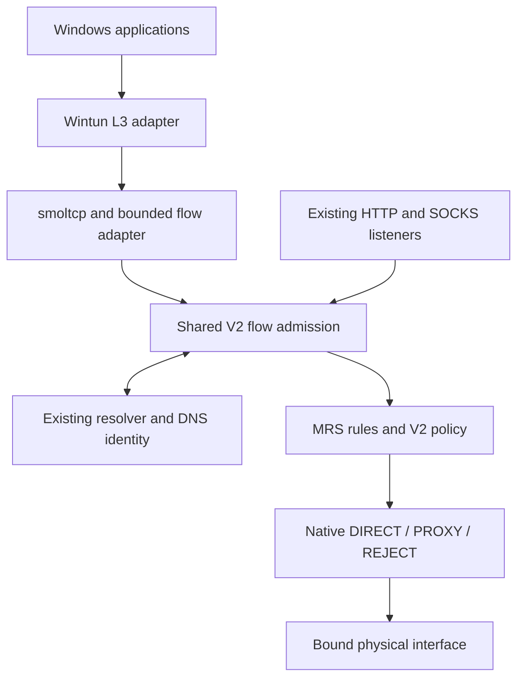

# Native Windows TUN: implementation, evidence and remaining acceptance

## Delivery status

The Rust packet backend, shared Core ingress, DNS identity adapter, Windows
network controller and versioned helper control are implemented on an isolated
branch. This continuation record is current through pushed commit
[`87c3f900b2628bac6040d670b458b727bda31a6b`](https://github.com/SOLHK/Swirl/commit/87c3f900b2628bac6040d670b458b727bda31a6b).
The [dedicated Native TUN run 40994211698](https://github.com/SOLHK/Swirl/actions/runs/40994211698)
passed on Linux and Windows. Its [Windows job](https://github.com/SOLHK/Swirl/actions/runs/40994211698/job/123863856692)
executed real Wintun successfully on Windows Server 2025, using PR merge source
`11852ebc49d4b51582583f42f94c39748200376b`. Both families passed scoped
DNS/TCP/UDP, TCP policy and exact restoration checks. This is real driver
evidence with loopback upstreams; Windows 11 and public-internet application
acceptance remain outstanding. The separate complete Rust Core and Qt workflow
results for the latest source remain pending in this record.

The original **870 tests / 45 targets** result belongs to the historical
`ffea437` evidence. A later complete local Linux run at
[`200225ebf44374e2e5a4156b67be3cf73993c63e`](https://github.com/SOLHK/Swirl/commit/200225ebf44374e2e5a4156b67be3cf73993c63e)
passed **884 tests across 46 targets, with zero failures, ignored tests or
filtered tests**, plus workspace fmt, check and Clippy with `-D warnings`.
The subsequent complete local validation of candidate
[`ab005b90670953e43ace45ff7f708730f40a7fd1`](https://github.com/SOLHK/Swirl/commit/ab005b90670953e43ace45ff7f708730f40a7fd1)
passed **890 tests across 48 targets, zero failed/ignored/filtered**, plus
fmt/check/Clippy. This candidate consists of `87c3f9` and the frozen UDP policy
smoke extension. Its added driver cases still need a new exact-source Windows
execution; the successful `87c3f9` run cannot establish them.

The subsequent CI-only change `418a1a5` enables the existing full native-protocol
workflow for this isolated branch. Its Windows/Linux/macOS official protocol
interoperability results are pending; no job or assertion was removed. These
checks are needed because the continuation changed native UDP/QUIC egress paths.

[Draft PR #42](https://github.com/SOLHK/Swirl/pull/42) carries the live exact-head
CI checks. The initial CI attempts found Windows journal access, native UDP
termination/publication and PowerShell 5.1 null-serialization defects; these
were fixed without changing the original assertions. The
workflow now also executes an explicitly scoped real Wintun smoke in a disposable
Windows runner. Only its successful logged result establishes that limited driver
test; the presence of the test or a Linux pass does not establish Windows success.

Companion documents:

- [Native TUN control API](NATIVE_TUN_CONTROL_API.md): JSON schema, Rust entry
  points, helper invocation, error handling and later Qt integration.
- [Dependency and security review](NATIVE_TUN_DEPENDENCIES.md): exact versions,
  licenses, driver hashes, notices, RustSec findings and their fixes.
- [Disposable Windows driver smoke](NATIVE_TUN_SMOKE.md): exact scope, explicit
  opt-in, restoration assertions and limits.
- [Successful Windows driver evidence at 87c3f9](native-tun-evidence/windows-wintun-87c3f9.json)
  and [its complete original job log](native-tun-evidence/windows-wintun-87c3f9-job.log).
- [Complete local candidate evidence at ab005b9](native-tun-evidence/linux-ab005b9.json)
  and [its original workspace log](native-tun-evidence/linux-ab005b9-tests.log).
- [Continuation evidence at 200225e](native-tun-evidence/linux-200225e.json) and
  [its full workspace log](native-tun-evidence/linux-200225e.log).
- [Historical evidence at ffea437](native-tun-evidence/linux-ffea437.json) and
  [its original full workspace log](native-tun-evidence/linux-ffea437.log).
- [Packet-stack boundary](../crates/swirl-tun/README.md): supported packet
  behavior, configuration limits and protocol exclusions.

## Baseline and parallel-development isolation

Delivery branch: `work/native-tun-windows-20261030-isolated`.
Audited baseline: `4ad8a23b7fd59f0f8c09f1e3547548b16baaf4e9` (`main`).
At checkout, `test` was `9d35542e092474056f6c154af351dbd84bf7fff4`,
one merge commit behind main. The latest `work/swirl-0219-clear-glass-20261029`
head (`6941ea37d5fe8dac128f38eca273d72aadbee1e0`) was already an ancestor
of main. These are the original audit observations, not claims about the present
heads of those branches. At PR targeting time, both commits had the identical
source tree `d20f5f9565c2fb839bc3a56409818e7a43281c40`. The feature PR targets
`test`, preserving the separate owner-approved `test → main` release gate.

The requested `work/native-tun-windows-20261030` remote branch was absent at the
initial inspection. During development it received continuing commits from an
external Cursor Agent. To preserve that work and the user's isolation constraint,
this implementation moved to the `-isolated` branch from the audited baseline.
The external branch was neither overwritten nor merged into this implementation;
no force-push or change to `main` or `test` was performed for this task.

This work does not change activity-page QML, cards, animation, fonts, themes,
icons or other visual resources. The existing Qt TUN switch remains disabled.
Delivery is by reviewable branch/PR, without automatic merging or a release.
The older promotion instructions in `AGENTS.md` concern a different candidate.

## Stage commits

| Stage | Commit | Delivered scope and acceptance boundary |
| --- | --- | --- |
| A | [`f8b5336d3fbe5160ec8eee40da5faac50a0514f7`](https://github.com/SOLHK/Swirl/commit/f8b5336d3fbe5160ec8eee40da5faac50a0514f7) | Actual-source architecture audit and isolation boundaries. At this commit, no TUN data-plane tests had run. |
| Dependency security | [`c31c05f0d745ae4cf04470598fa070767c77974e`](https://github.com/SOLHK/Swirl/commit/c31c05f0d745ae4cf04470598fa070767c77974e) | Fix the applicable locked TLS, ML-KEM dependency and zstd advisories; preserve checks and notices. |
| B | [`1720ba3d0d7f8e18c5754c22b34022f84a1c5215`](https://github.com/SOLHK/Swirl/commit/1720ba3d0d7f8e18c5754c22b34022f84a1c5215) | Bounded dual-stack smoltcp adapter, Wintun boundary, shared native Core entry and supporting DNS/network primitives. Portable tests establish packet/stream behavior; real Wintun is unverified. |
| C | [`f9fcd905de6dd04c55f3b7a67037be313d813153`](https://github.com/SOLHK/Swirl/commit/f9fcd905de6dd04c55f3b7a67037be313d813153) | Join L3 TCP/UDP and intercepted DNS directly to V2; full packet-to-Core loopback tests and explicit rejection. |
| D | [`0a4609654913ab27036bf5a09fb05c5dc4af7c57`](https://github.com/SOLHK/Swirl/commit/0a4609654913ab27036bf5a09fb05c5dc4af7c57) | Owned Windows lifecycle, persistent egress guard, helper supervision and versioned control. Windows network-switch, crash and restoration acceptance is still pending. |

Follow-up commits retain the evidence of the first CI failures:

- [`3c93c9583c48fc28dab0921ea6ef99f2c9e79496`](https://github.com/SOLHK/Swirl/commit/3c93c9583c48fc28dab0921ea6ef99f2c9e79496): pass Windows notice paths through argv, preserving exact inventory and byte checks.
- [`dc293997178a370326af822da2d515aa36964ba5`](https://github.com/SOLHK/Swirl/commit/dc293997178a370326af822da2d515aa36964ba5): read/write, exclusively locked Fake-IP journals with explicit EOF seeking after torn-tail repair.
- [`456d5c2b95e947d7ca4ffd2f57a1ced454be3c40`](https://github.com/SOLHK/Swirl/commit/456d5c2b95e947d7ca4ffd2f57a1ced454be3c40): one native UDP terminal cause even when channels close first or a runtime drops an unpolled task; correct dedicated loopback UDP binding.
- [`66f97ea87269322bf7c5341443e78bf59c2733ca`](https://github.com/SOLHK/Swirl/commit/66f97ea87269322bf7c5341443e78bf59c2733ca): bounded worker responses and final supervisor reports, with four fault-ordering tests.
- [`7d5c16623c8dfa7f1016b5d27ed605635b80f681`](https://github.com/SOLHK/Swirl/commit/7d5c16623c8dfa7f1016b5d27ed605635b80f681): explicit disposable-VM real Wintun TCP/UDP/DNS smoke and CI execution.
- [`7643a3abf4163aea0e1dd54c2af42c7b12d03455`](https://github.com/SOLHK/Swirl/commit/7643a3abf4163aea0e1dd54c2af42c7b12d03455): account successful native UDP bytes before waking senders/receivers, with three deterministic publication-boundary regressions.
- [`ffea437c612de0e15938f3576f5c0a89a17fadcd`](https://github.com/SOLHK/Swirl/commit/ffea437c612de0e15938f3576f5c0a89a17fadcd): emit explicit absent-resource JSON on Windows PowerShell 5.1, assign suspended network commands to kill-on-close jobs before execution, and bound stdin with the command deadline.

The original UDP-stop assertion reproduced on local iteration 25; after the
root-cause correction it passed 500 consecutive repetitions, in addition to
four deterministic close-order regressions. See the [before-fix failure](native-tun-evidence/udp-close-before-fix.log)
and [500-repetition evidence](native-tun-evidence/udp-close-500-repetitions.log).

The later Linux CI exposed a separate counter-publication race: a received
1,200-byte UDP response could be visible before its download counter. The fix
reserves queue space, updates counters, then publishes the response; sends
likewise account before completion. Three deterministic wake-boundary tests
preserve the original exact byte assertions. Each original IPv4/IPv6 bridge
test also passed 500 repetitions, recorded in the
[1,000-result log](native-tun-evidence/udp-accounting-1000-repetitions.log).

The first real-driver run at `7d5c166` failed while reading a missing owned
resource, before DNS/TCP/UDP traffic. Windows PowerShell 5.1 returns no output
for `ConvertTo-Json $null`; the backend now emits literal JSON `null` and keeps
strict decoding. The original failed [driver job](https://github.com/SOLHK/Swirl/actions/runs/40942647862/job/123690486733)
remains part of the evidence. Windows compilation and packet/unit tests in that
job passed; they did not turn its driver failure into an acceptance pass.

Stage E has a documented control contract, portable regression evidence and a
dedicated CI workflow. Exact-current-head Windows build results, real-machine acceptance,
privilege-separated product integration and installer sign-off remain gates,
not completed stages inferred from the presence of code.

## Continuation fixes and observed failures

These changes continue the existing backend and Draft PR. They do not replace
the completed architecture or weaken its tests.

| Commit | Root cause and correction | Evidence boundary |
| --- | --- | --- |
| [`11dc151`](https://github.com/SOLHK/Swirl/commit/11dc1510dc6483ab9b5d481929fc5d3285459e13), [`f0f19dc`](https://github.com/SOLHK/Swirl/commit/f0f19dcea4fd2ce734495e5e8bef54de80a4426d) | Diagnose the owned-resource snapshot, then read the real CIM `NlMtu` property instead of the `NlMtuBytes` setter parameter. Missing/null fields fail explicitly. Separate captured/restorable MTU from requested packet MTU while retaining family minima, requested maximum, journal validation, ownership checks and readback. | Real Windows diagnosis established the reader-produced zero values; PowerShell schema/decoder and transaction regressions cover the correction. That diagnosis was not a driver data-transfer pass. |
| [`81e2ff6`](https://github.com/SOLHK/Swirl/commit/81e2ff63affc2bbde776da069138aec0a047d462) | Reserve the QUIC import fixture's UDP port using a live UDP bind to port zero. A separately allocated TCP port does not reserve the same UDP port. Keep each imported endpoint tied to its actual transport fixture. | Corrects the Windows fixture bind failure; preserves ABI lifecycle and no-unexpected-traffic assertions. |
| [`aae75c8`](https://github.com/SOLHK/Swirl/commit/aae75c806a52e6b37f14d10cdb11d7897349c366) | Add a monotonic egress admission epoch to TUIC pool keys and validate it around cache admission and connection setup. Suspend, same-index rebuild, release and orphan recovery invalidate the former epoch. | Local dual-stack QUIC and epoch regressions exercise reuse/transition boundaries. Existing streams are not automatically migrated or globally cancelled. |
| [`0c421c2`](https://github.com/SOLHK/Swirl/commit/0c421c27f605613fdaa90c764016200857ae57b3) | Extend the scoped driver executable with durable Fake-IP reopen, TCP DNS/TTL, real Windows RST and connection reuse, live verified DoT policy controls, native HTTP CONNECT and exact original network configuration comparison. | Implemented assertions are described in the [smoke contract](NATIVE_TUN_SMOKE.md); compiling them is not executing them. Policy cases are TCP-only, with loopback upstreams. |
| [`e2abf18`](https://github.com/SOLHK/Swirl/commit/e2abf18fcd5b21b316891d7ab98097a6bf09b607) | A clean TCP DNS EOF previously returned without shutting down the TUN stream, so its drop emitted RST. Distinguish EOF before a fresh length prefix from a truncated prefix/body; explicitly finish complete streams with FIN and retain resets for malformed frames. | Both new IPv4/IPv6 packet regressions failed before the fix. Afterward all seven native bridge tests passed, including two messages on one TCP DNS connection and truncated-frame reset assertions. This was synthetic L3 with real Core/loopback components, not a Windows driver pass. |
| [`35f25d1`](https://github.com/SOLHK/Swirl/commit/35f25d154b540b4c75f826c18a756f98e84b9eb5) | Replace SS2022's direct Tokio UDP bind with the existing guarded transport path. Preserve explicit same-family loopback operation and buffer/error semantics. | Independent SIP022 peers cover both AES variants, both families and empty/full datagrams; Windows suspended-egress assertions are separate from full Wintun interoperability. Included in the later 890-test complete local run. |
| [`ad12646`](https://github.com/SOLHK/Swirl/commit/ad126469f59ed6b9b538a12a42784d9a85532e42) | Bind SOCKS5 UDP locally only when the validated selected relay address is loopback. A loopback TCP control connection must not exempt a non-loopback relay from physical egress checks. | Real dual-stack control/framing and empty/full UDP regressions, plus a separate Windows suspended-egress process. Included in the later 890-test complete local run. |
| [`65579b2`](https://github.com/SOLHK/Swirl/commit/65579b274766f9417da48e17344fef5acbada46c) | First native lease admission omitted automatic policy health jobs, which are separate from ordinary sessions and manual probes. Register their lifetime before task spawn/network IO and release through RAII; first admission also requires health quiescence. | A real loopback CONNECT health task held open reproduced the old admission error. The same test passed after the fix; success, rejection and cancellation paths release the count, including cancellation before first poll. Core-only regression passed 93 tests; this is not a new whole-workspace or Windows driver result. |
| [`1cf10df`](https://github.com/SOLHK/Swirl/commit/1cf10df10286f80dbf04943178d37d7f57c12ca9), [`87c3f90`](https://github.com/SOLHK/Swirl/commit/87c3f900b2628bac6040d670b458b727bda31a6b) | Real Windows read-only configuration snapshots expose inherited `MSFT_NetIPAddress.InstanceID` as null. Preserve that one field as a required nullable string, with no invented identity or missing-field default. Route identities and other field types remain unchanged. | Two diagnostic Windows jobs identified only address `instance_id` null paths. Regression checks retain null/string values, require the field, reject wrong types and retain equality sensitivity. The next Windows job passed all 44 platform tests and complete configuration comparison. |

The unresolved snapshot error inherited from the prior window is preserved in
[run 40948181560](https://github.com/SOLHK/Swirl/actions/runs/40948181560/job/123709717393):
`snapshot owned test resources: resource and value mismatch`.
The diagnostic [Windows job at 11dc151](https://github.com/SOLHK/Swirl/actions/runs/40989829936/job/123849683378)
then showed zero for both observed MTUs. Those zeros were manufactured by
`[uint32]` converting a missing `NlMtuBytes` property to null/zero; they were not
evidence that the driver's real `NlMtu` was zero. The correction reads `NlMtu`
and rejects absent/null data. `Set-NetIPInterface -NlMtuBytes` remains the correct
write parameter. The separate raw-MTU range correction preserves valid original
`u32` restore values without clamping; it does not make zero valid or establish
that an oversized MTU caused that CI failure.

The next schema failure was also investigated before changing a type. At
`1cf10df`, [Rust Core Windows run 40993465574](https://github.com/SOLHK/Swirl/actions/runs/40993465574/job/123861070163)
and [dedicated Windows run 40993465445](https://github.com/SOLHK/Swirl/actions/runs/40993465445/job/123861570915)
each reported 42 platform tests passed and one failed. The privacy-preserving
diagnostic listed nulls only at `/adapters/*/addresses/*/instance_id`; it did not
dump physical addresses or DNS values. These failures are retained, not
reclassified as successes. The narrowly scoped `87c3f9` correction leaves
`Journal::validate()` and the complete before/after configuration Eq in place.

The [Qt run 40989829927](https://github.com/SOLHK/Swirl/actions/runs/40989829927)
completed successfully at **11dc151**, including its full Qt regression. It is
historical evidence for that source only. The workflow adjustment
[`0aee089`](https://github.com/SOLHK/Swirl/commit/0aee089e8e5eec722156a22ec439239b29992e92)
keeps independent Qt network regressions running when an unrelated UI check
fails, while retaining the failing check. The latest separate Qt/Rust workflow
status must be recorded from its own completed runs. The dedicated Native TUN
workflow and real driver result for `87c3f9` are recorded below; an older Qt
success or a local Rust result does not substitute for another workflow's gates.

### First completed real Wintun transfer and restoration evidence

[Windows job 123863856692](https://github.com/SOLHK/Swirl/actions/runs/40994211698/job/123863856692)
checked out GitHub's PR merge `11852ebc49d4b51582583f42f94c39748200376b`, whose
checkout log identifies head `87c3f900b2628bac6040d670b458b727bda31a6b` merged
into `9d35542e092474056f6c154af351dbd84bf7fff4`. It ran on Microsoft Windows
Server 2025 Datacenter `10.0.26100`, image `windows-2025-vs2026`, Rust `1.99.1`
and the MSVC toolchain. The complete original
[job log](native-tun-evidence/windows-wintun-87c3f9-job.log) has SHA-256
`74ebdcd5f2300fea93582630ce45f2709284899176051474d0a60189d0d7e463`.
The [structured evidence](native-tun-evidence/windows-wintun-87c3f9.json)
retains the final executable JSON and the original snapshot/recovery values.

The job passed fmt, selected-package all-target Clippy with `-D warnings`,
**592 tests across 34 result groups**, and MSVC release builds of the Rust DLL
and helper. The 34 groups include doc-tests and are not the complete workspace
selection. All **44 platform tests** passed, including real PowerShell reads,
required nullable address identities, MTU properties and Job Object/process
regressions. The explicitly opted-in smoke loaded verified Wintun 0.14.1,
created its own adapter and installed exact synthetic-destination routes.
Actual Windows sockets generated **1,952 received and 1,719 sent Wintun packets**.

| Real driver assertion | IPv4 | IPv6 | Actual scope |
| --- | --- | --- | --- |
| DNS UDP and framed TCP | Passed | Passed | A/AAAA identity, TTL 30, durable Fake-IP close/reopen, two TCP query frames and clean completion. |
| TCP payload and half-close | Passed | Passed | 262,144 bytes per family through real Core loopback peers, with response after client FIN. |
| Connection reuse and RST | Passed | Passed | 64 rounds of 4,096 bytes on one connection; exact Windows `SO_LINGER=0` reset of a second tuple with independent cleanup. This is a finite regression, not a duration soak. |
| UDP datagrams | Passed | Passed | Empty and complete 1,200-byte datagrams through real direct loopback peers. |
| Native HTTP CONNECT | Passed | Passed | Native Rust protocol path, real verified DoT A/AAAA fixture, no static hosts override in policy cases. |
| REJECT and failed proxy | Passed | Passed | TCP rejection, HTTP 403 and connection refusal; exact Core outcomes and reachable DIRECT controls before/after, with no silent DIRECT fallback. |

The actual original MTU was **65,535 for both families**. The test requested
1,500, then recovery read back exactly 65,535. Both test addresses and both test
routes were absent before and after. Recovery reported `restored: 6`,
`already_restored: 0`, `conflicts: []`; every original resource readback logged
`exact: true` before adapter deletion. Packet resources returned to zero, the
owned adapter was absent, and default/split-default routes were unchanged.
The complete stable configuration comparison reported **8 adapters before and
after, 26 ActiveStore routes before and after, `adapters_equal: true`,
`all_routes_equal: true`**. Ordered DNS, address/interface fields, original MTUs
and route fields in that schema were compared, not just the counts.

The upstream peers were real loopback sockets, not public Internet destinations.
This test did not change physical DNS or firewall rules, install production
full-capture guards, inject helper crashes, switch Wi-Fi or run Windows 11 apps.
Its policy cases were TCP-only. Candidate
[`ab005b9`](https://github.com/SOLHK/Swirl/commit/ab005b90670953e43ace45ff7f708730f40a7fd1)
adds UDP policy driver assertions to this same smoke; those new cases await
their own real Windows run. The recorded `windows_11_application_acceptance`
and `long_duration_soak_acceptance` flags remain `false`.

## Stage A: findings at the audited baseline

The following table preserves the original findings at `4ad8a23`. The later
implementation addresses the missing pieces described here; the table is not a
current-feature checklist based on old documentation.

| Existing component | Source inspected | Baseline finding and reuse decision |
| --- | --- | --- |
| V2 runtime | `crates/swirl-core/src/v2.rs` | Immutable routing snapshots, prepare/activate/finish/rollback transactions, admission, node revocation and session records already existed. TCP ingress was coupled to HTTP/SOCKS negotiation; extract common flow admission and dialing. |
| Native TCP/UDP protocols | `crates/swirl-protocol/src/`, `swirl-core/src/socks5_udp.rs` | Native streams and datagram associations already existed. Reuse authentication, transports and association logic without a second proxy engine or a local SOCKS hop. |
| Rules and policy | `crates/swirl-routing/src/{v2,mrs}.rs`, `swirl-core/src/policy_v2.rs` | MRS domain/IP classification, service policies, rule tiers, fallback policy and explicit reject already existed. Select a route at flow admission. |
| DNS | `crates/swirl-dns/src/{lib,wire,dot,doh}.rs` | A/AAAA, bounded resolver concurrency, TTL/negative/failure caches, hosts, verified DoT/DoH and policy-selected encrypted query transport existed. An incoming DNS service and reliable IP-to-domain identity did not. |
| Platform | `crates/swirl-platform/src/lib.rs` | Only the system hosts-file path existed. Wintun, Windows network transactions and crash recovery needed implementation. |
| C ABI | `crates/swirl-api/src/{lib,control_v2}.rs`, `include/swirl_api.h` | A versioned bounded JSON command ABI existed; TUN capability was explicitly false. Extend the control boundary without changing the UI. |
| Qt bridge | `src/Swirl.Quick/engine/{RustCoreEngine,EngineController}.cpp` | Both explicitly rejected TUN. Keep the UI disabled until separate backend integration and acceptance. |
| Outbound network path | `swirl-protocol/src/dial.rs`, `swirl-transport/src/{udp,quic}.rs` | Outbound sockets followed system routing. Full capture required physical-interface binding for TCP, UDP, DNS and QUIC, beyond an exclusion for a single proxy-server IP. |

## Implemented data path and module boundaries



### Packet stack and common flow admission

[`swirl-tun`](../crates/swirl-tun/src/lib.rs) adapts L3 packets to correctly
sequenced TCP streams and UDP datagrams. smoltcp owns TCP state, retransmission,
windows, congestion control and checksums. Swirl supplies bounded admission,
packet queues, stream buffers, fragment adaptation and shutdown. Wintun packets
are never treated as a TCP byte stream. The stack handles SYN retransmission
without allocating another flow, separates equal ports at different addresses,
preserves half-close responses and resets an unforwarded rejected TCP flow.

[`FlowDispatcher`](../crates/swirl-core/src/native_flow.rs) exposes
`relay_tcp`, `open_udp`, `resolve_dns`, `runtime_handle` and
`prepare_native_tun`. Native and original proxy ingress share the V2 connection
budget, routing implementation, resolver, protocol dialing, session registry,
traffic counters and node-revocation barrier. Policy selection is retained for a
flow; packet forwarding does not repeatedly evaluate the full ruleset. Existing
sessions remain pinned to their selected outbound unless explicitly revoked.
A proxy error propagates without a retry through DIRECT.

UDP keeps a fixed destination and a bounded queue, preserves empty datagrams,
rejects undersized receive buffers explicitly and expires idle associations.
The bridge retains a failed/revoked UDP tuple for its idle interval rather than
silently creating a differently routed association for the next packet.
The [bridge](../crates/swirl-api/src/native_tun.rs) runs on the existing Core
Tokio runtime. Windows packet input uses one dedicated blocking reader; it does
not create another proxy runtime. Bounded resources are tested, but no measured
CPU, memory or throughput improvement is claimed.

### DNS identity and rule consistency

The packet bridge intercepts TCP/UDP port 53 and passes queries to
[`swirl-dns::tun`](../crates/swirl-dns/src/tun.rs), which validates them and asks
the existing policy-aware resolver for the requested name. It checks that the
requested IP family exists before returning a synthetic
A or AAAA address. An actual name error produces NXDOMAIN; empty results produce
NODATA; resolver, capacity and persistence failures produce SERVFAIL. It does not
invent successful DNS answers when the selected proxy or resolver fails.

Fake-IP identity is persisted before an answer is sent. IDs are never reassigned
to another name, including after restart; unknown or expired reserved addresses
fail closed. Responses have a 30-second TTL, mappings retain their identity for
300 seconds after allocation/refresh, and the Windows session allows 16,384
active names. The durable address sequence and 64 MiB journal have finite limits;
exhaustion fails instead of aliasing old addresses. Durable allocation runs on
bounded blocking jobs, outside Tokio's packet workers.

The Core recovers the canonical domain before applying domain/service policies.
Literal real-IP traffic still uses IP rules. A shared public IP is never guessed
to belong to a single domain. This reuses domestic/foreign classification,
global direct/proxy modes, custom rules, service policies, fallback policy and
REJECT from V2 rather than adding a TUN-specific rules engine.

The first native lease requires a quiescent Core and explicit validated encrypted
upstreams with numeric bootstrap endpoints. Active sessions, manual probes and
automatic policy health jobs prevent that first acquisition. Automatic health
jobs register their lifetime before task spawn and any network IO; a RAII guard
releases the count on success, failure or cancellation. The Windows controller
first acquires suspended egress, so a subsequently scheduled job cannot open a
new unbound socket between the quiescence check and capture. This admission fix
does not cancel every existing health or system-proxy connection on later
network rebuilds.

Prepare and activate both reject DNS downgrades while any native lease is held,
including transactions prepared before capture. A lifecycle lease persists
through bridge rebuilds so strict DNS admission cannot briefly revert to
plaintext/system lookup.

### Windows ownership, egress and recovery

The [Wintun boundary](../crates/swirl-platform/src/wintun_device.rs) verifies the
absolute local DLL path and pinned official architecture hash before loading;
it keeps a file lock and restricts dependent-DLL lookup. It creates a dedicated
adapter and does not adopt or overwrite an existing same-name adapter. Unsafe
Windows operations remain isolated in the platform boundary.

The [typed transaction](../crates/swirl-platform/src/network_transaction.rs)
records before/after values, adapter identity, ownership and write progress in
a durable journal. Recovery compares the current state with the state this
owner installed. Conflicting third-party changes are preserved and reported;
the journal remains available for recovery. The
[Windows backend](../crates/swirl-platform/src/windows_network.rs) configures
TUN addresses, MTU, DNS and split default routes, plus port-53 guards on the
known hardware adapters. It does not replace physical DNS settings or delete
physical default routes.

The read-only [configuration snapshot](../crates/swirl-platform/src/windows_network.rs)
used by the smoke enumerates all existing adapters, including hidden adapters,
and retains interface identity, IP-interface configuration, addresses, ordered
DNS server lists and all ActiveStore routes. It excludes time-decaying lifetimes
and traffic counters, but does not discard duplicate rows, reorder DNS priority
or erase IPv6 scope information. An empty adapter enumeration or failed read is
an error. The original and restored snapshots must compare equal after the
temporary adapter is removed. This observation API adds no mutable resource type
or recovery privilege. Its actual Windows schema and equality assertion passed
in the `87c3f9` driver run; subsequent source changes require their own execution.

[`EgressLease`](../crates/swirl-transport/src/egress.rs) binds newly created
Core TCP/UDP/QUIC/DNS sockets to the selected physical interface. Missing
families fail closed. The owner spans running, waiting and rebuilding states;
it suspends new Core egress before teardown and updates the interface selection
before recapture. It is released only after owned routes are restored. Keeping
this guard across a pause prevents newly admitted unbound Core sockets from
entering the next capture generation. TUIC pool keys also include the egress
epoch, preventing a cached client from being admitted across suspend/rebuild,
even when the next physical interface index is unchanged. Existing sockets are
not transparently migrated to a new physical network, and this epoch check is
not a substitute for cancelling all already running flows.

[`NativeSession`](../crates/swirl-api/src/native_windows.rs) watches network
change notifications and packet-pump failure, restores the current transaction,
and retries building a bridge when a physical network becomes available. A
recovery conflict stops automatic rebuilding. Normal stop restores the journal
before closing the device and joining bridge/I/O work. Controller destruction
cleans native sessions while Core runtimes are still alive.

The [helper](../crates/swirl-api/src/bin/swirl-tun-helper.rs) accepts bounded
JSON lines on private inherited stdio, without a public RPC or shell-command
endpoint. Its supervisor attempts journal recovery before starting a worker and
after worker termination. Recovery precedes output-thread joining and is not
skipped when waiting or output forwarding fails. Worker responses use a single
bounded writer with a two-second acknowledgement timeout; timeout poisons the
output connection and triggers restoration before exit. Forwarder draining and
the final supervisor report also have bounded waits. Clients must still drain
stdout continuously; a timeout is an error, not a delivered response.

GUI input EOF causes the supervisor to close worker stdin; the worker's input
EOF path stops native sessions before dropping Core. A supervisor exit also
closes the inherited input pipe, while a surviving supervisor attempts recovery
after worker exit. These are implemented lifecycle paths with portable
fault-ordering tests, not completed Windows crash-injection acceptance. If both
processes die or the machine reboots, no installed service automatically performs
recovery: the next `--serve` startup or explicit `--recover` must reconcile the
journal. There is also no whole-worker watchdog around an indefinitely live
worker; the bounded command and output deadlines do not bound every device
reader join or bridge shutdown.

The physical DNS guards cover TCP and UDP remote port 53 on all hardware aliases
recorded at setup, for either IP family and any local/remote address. They do not
change physical DNS settings. Setup verifies the firewall service, enabled
profiles and local-rule policy, and owned-rule comparison includes the actual
filters. The network watcher observes interface, route and unicast-address
changes; it does not continuously observe firewall rule deletion, service stop
or profile/policy changes. `dns_guard_active` is currently derived from the
controller's running state, not a fresh firewall inspection. New adapters and
administrator changes therefore require real multi-NIC/IPv6/LAN leak testing and
stronger ongoing guard verification before continuous protection can be claimed.

Each PowerShell network command starts suspended and joins a private
non-inheritable kill-on-close Job Object before its initial thread resumes.
Normal exit, timeout and owner loss clean up its process tree; input writes use
the same deadline as execution. Four Windows process tests cover suspended
ownership, last-handle closure, pre-assignment failure and descendant pipe
closure, alongside a blocked-stdin deadline test. These are OS process tests,
not proof of network rollback. An already submitted CIM/WMI operation can run
outside that tree, so recovery still requires owned journal comparison and
readback. A host crash between process creation and job assignment can leave an
unexecuted suspended orphan; the implementation does not claim atomic creation.

## Dependency decision and security evidence

The selected stack is smoltcp **0.14.0 (0BSD)** with the **0.5.1 MIT Wintun Rust
binding** and separately verified **Wintun 0.14.1** binary. The binding's MIT
license does not license the driver binary. The
[dependency review](NATIVE_TUN_DEPENDENCIES.md) records that distinction, upstream
source inspection, MSRV, exact checksums and redistribution notices.

`netstack-smoltcp` 0.2.4 was inspected and rejected because of unbounded internal
queues, per-SYN allocation before tuple deduplication and an invalid-UDP path
which could terminate the stream. The chosen code adapts the mature smoltcp
state machine; it does not reimplement a TCP/IP stack.

The recorded dependency-review lockfile's unfiltered RustSec audit reported zero
vulnerabilities and zero warnings with `--deny warnings`, after fixing the initial seven
vulnerabilities and ten warnings. No advisories or tests were suppressed. The
full advisory applicability record and notice-staging changes are in the
dependency review. Audit success is bounded by that database and source state;
it does not establish driver, application or installer correctness.

## Test evidence: portable, packet simulation and Windows are separate

The historical run at `ffea437` exercised all workspace targets and reported
**870 passed, 0 failed, 0 ignored, 0 filtered, 45 test targets**. Its
[raw log](native-tun-evidence/linux-ffea437.log) and
[structured record](native-tun-evidence/linux-ffea437.json) remain unchanged.
That record's tested `Cargo.lock` SHA-256 is
`a2adc62304af61b3d9c4faf7935b5572783f295510719f45fef9d74185175941`;
it is not the lockfile identity of every subsequent commit.

The complete continuation run at `200225e` used the following commands from
`core/`. Dependencies were already present locally; `--offline --locked` prevents
network dependency resolution and lockfile changes:

```sh
cargo fmt --all -- --check
cargo check --offline --locked --workspace --all-targets
cargo clippy --offline --locked --workspace --all-targets -- -D warnings
cargo test --offline --locked --workspace --all-targets
```

All four commands exited successfully. The test result is **884 passed,
0 failed, 0 ignored, 0 filtered, 46 test targets**. The
[structured record](native-tun-evidence/linux-200225e.json) identifies the commit,
tree, source hashes, commands, execution environment, every result and the
SHA-256 of the original [test](native-tun-evidence/linux-200225e.log),
[fmt](native-tun-evidence/linux-200225e-fmt.log),
[check](native-tun-evidence/linux-200225e-check.log) and
[Clippy](native-tun-evidence/linux-200225e-clippy.log) output. Fmt's empty log is a
successful silent command, not a missing record. The tested `Cargo.lock` SHA-256
is `1c539260d5bfdcbc332ea217a81a113257918b129c06cf8a1afdbe3029c8dd42`.
Targets with zero tests are included in both target counts; those counts are not
counts of independent Windows scenarios.

At `87c3f9`, a separate fresh Core-only `cargo test --offline --locked -p
swirl-core --all-targets` run passed **93 tests across six targets**, with zero
failures, ignored or filtered tests. This includes the four automatic-health
lifecycle regressions. Targeted SS2022/SOCKS5 regressions and Windows GNU
cross-compilation are likewise component evidence; GNU cross-compilation does
not execute Windows process, network or driver tests.

The final local candidate run at `ab005b9` used the same four commands and
passed **890 tests across 48 targets, zero failed/ignored/filtered**, with every
command exit status zero. Its [structured record](native-tun-evidence/linux-ab005b9.json)
links the original [test output](native-tun-evidence/linux-ab005b9-tests.log),
[fmt](native-tun-evidence/linux-ab005b9-fmt.log),
[check](native-tun-evidence/linux-ab005b9-check.log),
[Clippy](native-tun-evidence/linux-ab005b9-clippy.log), and
[source manifest](native-tun-evidence/linux-ab005b9-source.json). The execution
script verified the frozen smoke SHA-256 before and after the run:
`a450d009468f1dbd38fcd0f762ae7d9b837ef932c9308fdbd4594d8a0bd2fa18`.
This run includes the later health and UDP egress fixes, but compiling the
Windows example on Linux does not execute its new UDP driver policy cases.

The following groups describe evidence classes, not additional totals to add to
the workspace totals or a declaration that every current-head CI gate has passed.

| Evidence class | Actual coverage | Limit of the evidence |
| --- | --- | --- |
| Portable unit/regression | Existing policy/MRS, resolver, protocols, imports, subscriptions, ABI and system-proxy regressions; typed journal failure/ownership recovery; helper wait/output failure ordering. | No Windows adapter, firewall or real routing changes occurred. |
| Synthetic L3 packet tests | 14 [packet-flow tests](../crates/swirl-tun/tests/packet_flows.rs): IPv4/IPv6 TCP and UDP, checksums, half-close, flow isolation, SYN deduplication, fragment reassembly, saturated queues, reset and byte-exact 1 MiB transfer with small buffers. | This validates the stack against packet peers, not Wintun or internet performance. |
| Packet bridge with real loopback sockets | Seven [integration tests](../crates/swirl-api/src/native_tun_tests.rs) at `200225e`: the original five A/AAAA/Fake-IP, TCP/UDP, rejection, counter and shutdown tests, plus two dual-stack TCP DNS FIN/truncation regressions. | Real OS TCP/UDP is exercised on Linux; packet ingress is synthetic. No public internet or Windows application was exercised. The historical `ffea437` result contained the earlier five-test group. |
| Shared Core networking | [Native flow tests](../crates/swirl-core/src/native_flow_tests.rs) and [V2 runtime tests](../crates/swirl-core/src/v2_runtime_tests.rs): dual-stack loopback, independent proxy/TLS peers, certificate failure, no DIRECT fallback, shared admission, budget reuse, DNS lease races, node revocation and UDP publication ordering. Core passed 89 tests in the `200225e` workspace run and 93 in the later `87c3f9` Core-only run. | These establish native integration and health admission with the existing Core, not every protocol over a real Windows TUN or cancellation of all old flows during a physical handoff. |
| Windows process, schema and build | Job 123863856692 passed the selected-package suite, including 44 platform tests, and MSVC release DLL/helper builds at PR merge `11852eb` for head `87c3f9`. | Process/schema and build results alone do not establish packet transfer; the separate driver result does. Later source and full Rust/Qt workflows retain their own gates. |
| Scoped Windows driver test | [Run 40994211698](https://github.com/SOLHK/Swirl/actions/runs/40994211698) passed the real socket/driver and restoration assertions above. | Disposable Windows Server 2025, exact test routes, TCP-only policy cases, loopback upstreams. Physical DNS guards and Windows 11 apps were not exercised; new `ab005b9` UDP policy cases remain pending. |
| Qt/system-proxy product regression | [Run 40989829927](https://github.com/SOLHK/Swirl/actions/runs/40989829927) completed successfully at `11dc151`. | This is an older-head regression result, not an `87c3f9` result, TUN UI integration or Windows 11 application acceptance. |

No local test installed a driver or modified the development host's routes,
DNS or system proxy. No tests were deleted, ignored, weakened or redirected to
an external proxy core to obtain the recorded result.

## Known limitations and required Windows acceptance

**Capture is interrupted during network recovery.** The controller restores
capture routes and port-53 guards while waiting for a usable physical network.
Its persistent egress guard protects Core socket creation, but there is no
system-wide traffic kill switch. Other applications may use a physical route
during that interval. Status exposes capture/DNS-guard state; uninterrupted
system-wide capture and leak-free handoff must not be advertised.

**Old flows are not globally cancelled on rebuild.** `NativeSession::maintain`
suspends new egress and tears down its own bridge tasks. It does not cancel every
Core system-proxy session, manual probe or automatic policy health task. An
already opened socket retains its former interface binding; epoch validation
blocks stale TUIC admissions but does not move or terminate all established
streams. The first-lease health fix closes the admission omission only. Real
physical-interface switching, ongoing health probes and existing system-proxy
flows still need observed cancellation/recovery behavior before stronger claims.

**DNS guard liveness is not continuously verified.** Port-53 installation and
owned-resource recovery validate the rules, but an administrator removing a
rule, disabling the firewall or changing its policy need not trigger the current
network watcher. The running-state `dns_guard_active` field is not independent
proof of rule presence. Hardware IPv4/IPv6, LAN-specific routes, newly attached
adapters and multi-NIC changes remain real-environment acceptance cases. Physical
egress selects the eligible lowest-metric default interface per family, not an
independently selected interface for each LAN destination.

**Crash recovery still needs a surviving or restarted process.** Normal stop,
input EOF and supervisor recovery paths are implemented. A simultaneous
helper/worker crash or reboot leaves reconciliation to the next helper start or
explicit recovery command. No boot-time recovery service or whole-worker hang
watchdog is installed. The command Job Object and stdout deadlines cannot prove
that an entire worker shutdown or actual Windows network restoration completes.
Owned recovery preserves conflicting later VPN/DHCP/administrator changes;
restore-operation errors currently become conflict indices, limiting the detail
available for diagnosing some Windows failures.

**Privilege separation is incomplete.** The ordinary GUI/DLL controller rejects
network mutation with `TunHelperRequired`, and the helper uses private inherited
stdio and a protected state directory. However, its ordinary worker spawn
inherits the helper token: Core protocol parsing, DNS and the packet pump remain
in the elevated worker. There is no restricted-token data plane, automatic GUI
UAC launch or completed authenticated product IPC/install workflow. The Qt GUI
must not be elevated to bridge this gap.

**DNS support is intentionally narrower than a general recursive DNS server.**
The synthetic path supports A/AAAA; HTTPS/SVCB return NODATA to avoid address hints
bypassing name identity, and other record types return NOTIMP. Fake answers do
not assert DNSSEC authentication. Application-owned encrypted DNS is not
intercepted and can result in literal-IP traffic without domain-rule identity.
The finite durable mapping requires future operational lifecycle work; deleting
its journal is not a safe way to recycle addresses still cached by applications.

**Packet and product exclusions remain.** There is no ICMP relay and no claim
of support for arbitrary IPv6 extension chains. QUIC can use native UDP paths,
but real Windows QUIC/application compatibility remains unverified. There is no
new UI toggle. Source/license staging is implemented, but the final driver,
helper and Rust DLL installer payload, source identity and installation/recovery
experience have not received product acceptance.

| Required acceptance scenario | Current status |
| --- | --- |
| Disposable Windows CI scoped Wintun TCP/UDP/DNS and exact restoration | **Passed at `87c3f9` / merge `11852eb`** with the precise source and scope above. Subsequent `ab005b9` UDP policy cases await their own Windows CI. This pass does not establish full physical capture or Windows 11 applications. |
| Windows 11 Wintun TCP/UDP internet traffic, IPv4 and IPv6 | **Not run.** Requires an approved recoverable Windows environment, administrative network operations and the verified driver. |
| Domestic direct, foreign proxy, global modes, custom and application policies | Portable MRS/policy and loopback paths pass; scoped driver adds TCP HTTP CONNECT, REJECT and fail-closed cases. **Real Windows internet destinations, proxy UDP policy and application/service behavior remain unverified.** |
| DNS leaks, multihomed DNS, proxy-server route loops and other VPN conflicts | Guards, preflight and ownership tests exist; **real Windows network observation not run**. Application-owned DoH, runtime guard removal and the recovery gap remain explicit limits. |
| Chrome, VS Code and Codex | **Not run through real TUN.** Existing import/ABI regressions do not establish application connectivity. |
| WebSocket, SSE and long-lived connections | Native stream/half-close regressions pass; **Windows application sessions and sustained TUN operation not run**. |
| Wi-Fi disconnect/reconnect, interface handoff, sleep/wake | Watch/retry and admission-epoch implementation exists; **real Windows events not run**. All older Core/health/system-proxy flows are not yet globally cancelled or migrated. |
| Normal exit, worker crash, supervisor crash, simultaneous crash and machine restart recovery | Scoped Windows smoke teardown restored its six resources and full original configuration exactly. Portable journals and supervisor ordering pass; **actual helper/worker crash and reboot restoration trials not run**. No boot-time recovery service is installed. |
| Large transfer, CPU and memory pressure | Byte-exact bounded-buffer 1 MiB packet transfer passes; **sustained Windows load and resource measurements not run**. |
| Existing system-proxy and Qt product behavior | Complete local Rust regression passed at `ab005b9`; dedicated Native CI passed at `87c3f9`; Qt passed at `11dc151`. **Latest separate complete Qt/Rust workflows and the new driver source remain pending.** TUN product integration and installer sign-off have not run. |

Stages D/E can be accepted only after those trials produce source-identified
logs and before/after network evidence in a disposable Windows environment.
A successful Actions build alone must not change any of these items to passed.

## Subsequent Qt integration

Use the existing bounded C ABI/JSON boundary and the independently versioned
`native_tun_schema: 1` commands documented in the
[control API](NATIVE_TUN_CONTROL_API.md). The ordinary DLL controller cannot
start, stop or recover Windows networking; those commands require the helper's
controller. Create the V2 Core in the same worker that will own capture and use
that worker's returned handle/engine epoch. A GUI-process Core handle is not a
cross-process capability.

The integration must retain V2 transactions for rule/node changes, continuously
read helper responses, present waiting/recovery conflicts honestly and stop the
native session before releasing its Core. The helper interface accepts no
second rule system or alternate protocol kernel. Keep the current UI capability
disabled until that separate integration and the required Windows acceptance
are complete. The capability flags remain `real_windows_11_acceptance: false`,
`system_kill_switch: false`, `capture_continuous_during_network_restart: false`
and `automatic_gui_elevation: false`.
