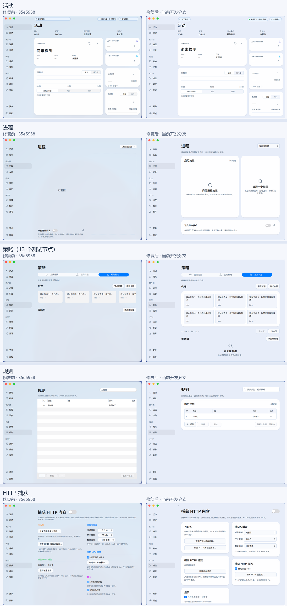
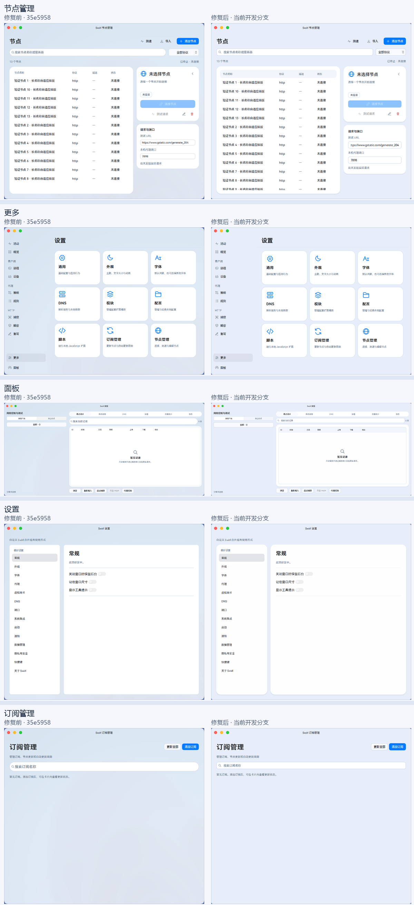
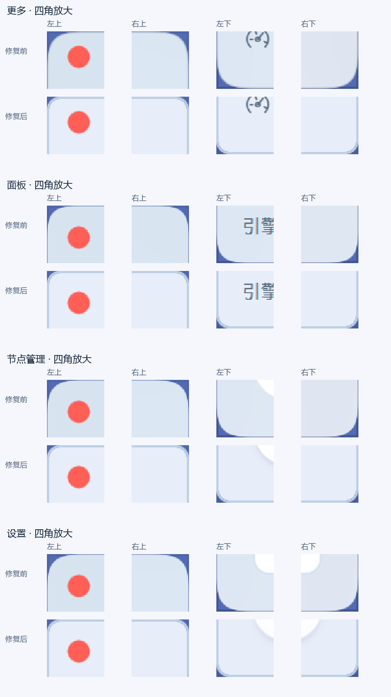

# PR #12 界面基础质量验收

2026-10-15。基线 `35e5958`；仅更新 `feat/phase3-system-proxy-ui`，PR 的目标仍为 `test`，没有合并 `main`。本轮集中修复窗口、材质、圆角、控件与布局，没有扩展网络内核功能。

## 公共层修复

| 公共组件 | 最终行为 | 一起覆盖的页面 / 窗口 |
| --- | --- | --- |
| `WindowsBackdrop` | Windows 11 Desktop Acrylic；DWM 统一裁切完整 HWND；去掉 `WS_EX_LAYERED` 冲突；不使用系统标题栏按钮，也不绘制顶部标题色带 | 主窗口、更多、面板、节点、设置、订阅、配置、模块、脚本等二级窗口 |
| `SwirlSecondaryWindow` | 二级窗口统一材质、红绿灯标题区、内容安全区边界、最小尺寸与主题响应；后续二级窗口继续复用 | 面板与全部设置类独立窗口 |
| `SwirlGlassMaterial` | 只叠加冷蓝色与遮蔽度，不读取壁纸、不截桌面、不模糊前景文字 | 全部窗口 |
| `SwirlContinuousSurface` | 保留兼容 API，统一为 Qt 原生圆弧矩形；软件与 GPU 使用同一几何 | 按钮、下拉框、对话框、表格遮罩与使用此组件的卡片 |
| `Theme` / `SwirlGlassPanel` | 卡片半径 20、主要内容内边距 20；公共卡片不再随页面 A/B 分支改变边框和阴影规则 | 活动、进程、规则、HTTP、节点、设置、更多 |
| 按钮、输入、搜索、下拉框 | 常规高度 32、半径 8、边框 1、焦点边框 2、横向内边距 12；统一悬停、按压、禁用状态 | 各页面的表单与操作栏 |
| `SwirlDataTable` | 常规表头 36、数据行 40、容器半径 10；最简表头也有圆角；不生成空数据条纹 | 节点、规则、进程、面板等表格 |
| 状态胶囊 / 滚动条 / 空状态 | 状态高度 26、内容决定宽度、统一蓝色底；可滚动区域保留细提示条；空状态说明可换行 | 活动顶部、所有相关滚动页面与空列表 |

数值均为 Qt 逻辑设计单位，随用户 UI 缩放调整；DPI 由 Qt 原生处理。外窗采用系统 `DWMWCP_ROUND`，不再混用 24、27、28 的自定义外框曲线。控件、表格和卡片按层级使用 8 / 10 / 20 半径，几何都使用圆弧，避免同一套控件在 GPU 与软件路径上曲率不同。

## 四角根因与处理

之前只在 QML 背景 shader 中裁出连续曲线，Qt/Win32 仍保留完整的透明 HWND。内容、矩形表头、底栏与背景不属于同一个最终裁切对象；独立窗口还采用不同半径，外框描边和阴影也不能保证与所有子内容一致。结果是子内容可能越过背景轮廓，留下白角、浅色残片或漏底。

另外，Qt 的无边框 + alpha 配置会设置 `WS_EX_LAYERED`。微软明确说明，逐像素分层窗口或应用自己设置的窗口区域，不能由 DWM 正常圆角化。旧实现又明确设置 `DWMWCP_DONOTROUND`，关闭了系统外框裁切。仅检查 `QQuickWindow::grabWindow()` 中的 alpha，不能证明 Windows 最终合成结果没有残影。

现在 GPU 路径移除分层样式，不设置自定义 Win32 区域，保留透明 D3D 表面与系统材质，由 DWM 在 QML 内容、背景与外框完成合成后统一裁切。二级窗口共用容器，外框不再叠加另一套 QML 曲线。关闭非客户区标题绘制，既保留红绿灯，也消除原生标题色带；未添加微软的最小化、最大化、关闭按钮。系统窗口样式仍保留缩放和系统菜单能力。

不支持原生路径时使用同一圆弧半径的窗口区域与不透明底色。该兼容路径的边缘抗锯齿不等同 Windows 11 的 DWM 路径，不能据本次结果宣称 Windows 10、远程桌面等环境已达到相同材质效果。

## 材质与蓝色参数

采用 `DwmSetWindowAttribute(DWMWA_SYSTEMBACKDROP_TYPE, DWMSBT_TRANSIENTWINDOW)`，即当前 Windows 11 的 Desktop Acrylic，并结合 `DwmExtendFrameIntoClientArea`。选择 Acrylic 是为了让真实后方窗口/桌面经过系统模糊参与合成；Mica 的壁纸取色不符合本轮“真实桌面透过”的要求。

删除生产中的 `WallpaperBackdrop` 与图片提供器，界面不再读壁纸、缓存桌面采样图或自行合成“桌面”。保留的合成模糊基准代码只用于显式测试，不参与产品背景。

- 浅色叠层：`#EAF1FF`，alpha `0.86`，即 RGB `(234,241,255)`。
- 深色叠层：`#1E2B43`，alpha `0.90`。
- 浅色卡片维持约 98% 遮蔽；主要内容优先可读。
- 蓝色通道明显高于绿色；取消壁纸带来的青绿变化以及原生标题区的系统暖色/绿色强调色。
- 模糊由 Windows Acrylic 控制，不声称设置了自定义的系统模糊半径。Swirl 负责叠层与内容遮蔽，不让文字参与背景模糊。
- 系统关闭透明、高对比度、节电、远程会话、软件渲染或不支持 API 时使用不透明回退；没有伪造桌面回退。

最终受控背景测试：高对比文字与纯色背景切换，在空白页边区域的 RGB 差异均值 / 峰值为 `0 / 0`；红蓝大色块切换的三通道差异和为 `33`，说明仍保留低强度的真实背景变化。顶部红绿灯与系统代理所在行的背景对照差值为 `0`，没有横向标题色带。这些数据仅针对本次固定采样区和本机，不代表所有壁纸、GPU 与显示模式。

## 各页面结果

| 页面 | 修复 |
| --- | --- |
| 活动 | 事件胶囊按文字收缩，与代理/增强模式属于同一控件家族；警告由状态点表达；连接卡片重新分配标题、主数值、进程说明、底部 DHCP 统计的留白；常用卡片在最小默认视口完整展示 |
| 进程 | 约 3:2 列表与详情；两个内容区统一卡片；没有流量与没有选中进程分别显示明确空状态；计费网络入口保留 |
| 节点 | 搜索与协议筛选同高同圆角；操作栏对齐；表格表头取消直角；详情与请求卡片使用统一安全区；连接、导入、测速、编辑等功能保留 |
| 策略 | 完整自适应节点网格 + 明确上一页/下一页；13 个测试节点实测分页，长名称可换行并可查看完整提示；不再裁半张卡片；策略组无数据时有说明 |
| 规则 | 只绘制真实数据行；少量规则使用自然内容高度；搜索、表格、操作栏重新排列；真实空状态与筛选无结果分离；添加/编辑/删除入口保留 |
| HTTP 捕获 | 等宽分组卡片；按钮与三种限制下拉框统一；说明与控件间距统一；小窗口纵向滚动，所有入口保留；尚未接入的显示合并选项标研发中 |
| 面板 | 使用公共二级窗口；统一外框与四角；表格使用公共尺寸与留白；六标签、搜索与实际操作入口保留 |
| 更多 | 入口全部保留；统一卡片圆弧与安全区；作为二级窗口入口中心继续使用 |
| 设置 / 订阅 | 使用同一二级窗口与公共表单规范；主窗口与独立窗口不再各自叠加不同轮廓 |

## 截图

下图是本机 Windows 11 / Qt 6.10.3 / D3D11 的实际桌面合成截图汇总，主对比 DPR=1.5；不是仅渲染 QML 的 alpha 图片。基线界面采用真实壁纸路径，两版均在本机受控背景前打开，保留同样的空数据和本机测试节点状态。图中节点均为未发起连接的回环地址测试条目，没有真实订阅或凭据。





四角依次为左上、右上、左下、右下；每组上排修复前、下排修复后。只进行像素放大，未修图。



本地交付还包含逐页原图、HTTP 页下部截图、深色截图、100/125/150/200% DPR 原生截图、JSON 与原始日志，以及可点击原图的 HTML 图集。

## 验证

- 最新 UI 原生验收：142 项，0 失败，包含所有关键窗口四角、Desktop Acrylic 实际属性、无分层窗口冲突、无系统标题按钮、无顶部色带、透字对照、13 节点分页鼠标操作、节点筛选尺寸与 HTTP 下部入口。
- 100%、125%、150%、200% 实际进程 DPR：各 135 项，0 失败。100% 通过抵消本机原生 150% 乘数实现；不是修改 Windows 系统 DPI，不等同四种实体显示器覆盖。
- 窗口原生交互：64 项，0 失败；包含系统缩放/菜单、全屏/恢复、最小化/恢复、红绿灯关闭，以及恢复后没有系统标题按钮和分层样式冲突。
- 实际 UI 鼠标/键盘回归：63 项，0 失败；主题切换和独立进程恢复通过。
- 卡片共享转场、节点选择返回、更多与面板六标签：34 项，0 失败。旧测试要求 Qt 原始角落 alpha=0；已改为检查最终轮廓的实际所有者，最终裁切由专门的 DWM 截图检查负责。
- 相关 CTest 8/8 通过（100.97 秒）：字体、流量统计、节点 UI、引擎 UI、页面输入、61 页遍历、动画、HTTP 捕获。原生截图、主题、共享转场与进程 DPI 检查均单独运行。

原生检查可在测试构建、解锁桌面下运行：

```powershell
Swirl.exe --ui-quality-test --ui-quality-output=C:/path/to/evidence
Swirl.exe --window-test --window-test-output=C:/path/to/window-evidence
```

所有网络测试使用临时隔离数据；截图不导入私人订阅，不把测试节点标为已联网。初次节点/引擎测试因构建目录缺少固定版本 Mihomo 失败；补齐清单中 SHA256 对应的既有依赖后通过。早期前台激活失败和旧 alpha 假设导致的失败未当作成功截图，原始诊断保留。

## 当前边界与已知问题

本机关键窗口的白角、残影、漏底、顶部横带和系统标题按钮问题未再复现；这不等同所有设备验收。尚未覆盖实体多屏切换、其他 GPU、物理 4K/HDR 与远程桌面的材质表现。Windows 最大化/贴靠时的方角属于系统窗口规则；不是普通窗口残留了另一套圆角实现。

HTTP 页在最小视口需纵向滚动；策略节点多时分页；很长的节点名称在表格中省略，卡片可换行并有完整提示。这些是明确的内容处理方式。HTTP 显示合并、规则计数器重置等未完成能力继续标研发中，没有借本轮视觉修复声称功能已经实现。

参考：[微软背景材质 API](https://learn.microsoft.com/en-us/windows/win32/api/dwmapi/ne-dwmapi-dwm_systembackdrop_type)、[微软圆角限制](https://learn.microsoft.com/en-us/windows/apps/desktop/modernize/ui/apply-rounded-corners)、[Qt Windows 窗口样式实现](https://github.com/qt/qtbase/blob/dev/src/plugins/platforms/windows/qwindowswindow.cpp)。
