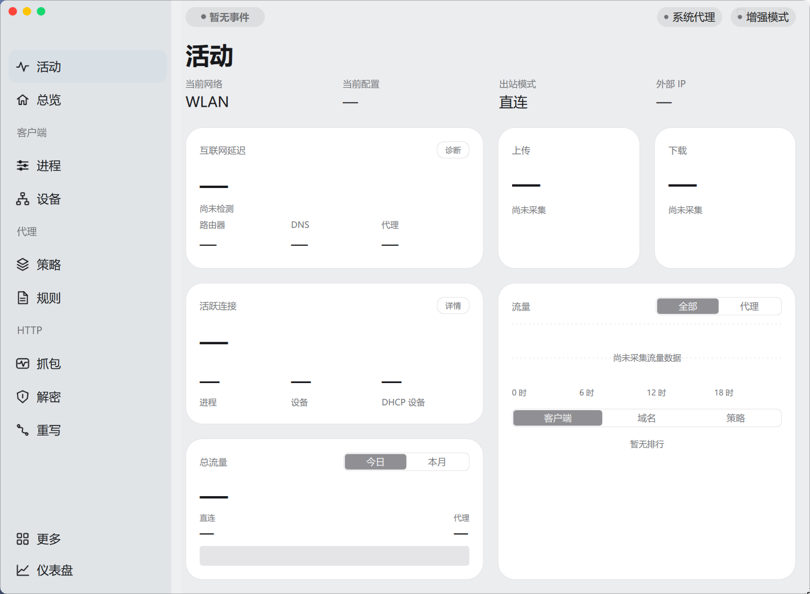
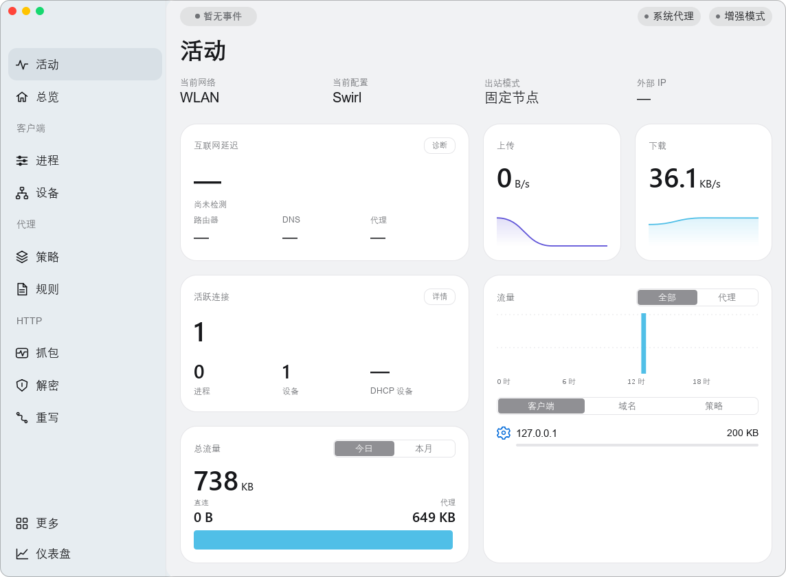

# Activity reference implementation

Reference: the user-supplied Surge Activity screenshot from https://nssurge.com/.
Work starts from `test` at `a83d2b2`, not the older `main` UI preview.

## Architecture and scope

The app is C++23 / Qt 6.10 Quick, with QML routes held by `SwirlPageHost`.
`EngineController` is the business facade; `MihomoAdapter` owns the pinned
Mihomo process and authenticated loopback API. `CaptureService` remains a
separate, opt-in HTTP capture service. SystemProxy manages a WinINet lease after a connected node becomes ready,
restoring all prior flags, server, bypass and PAC on disconnect/exit. A journal
recovers abandoned settings; a lock prevents concurrent Swirl leases. External
client changes are preserved. Isolated tests use an injected memory backend.
TUN remains disabled.

Activity is now the initial route. Overview retains network/configuration,
node selection and system controls. Additional routes remain available through
More and Ctrl+K. Connections retain filtering and details, now backed by the
engine's actual connection snapshot; closing a selected active connection
uses its validated engine ID.

Navigation and Activity labels are Chinese, retaining technical names such as
HTTP, DNS and IP. Two running screenshots are provided below. The native
capture has no engine running; the stream capture uses actual loopback HTTP
traffic through the owned Mihomo and a controlled SOCKS relay.

## Reference measurements

The supplied image contains a window approximately x=73..1445, y=46..1054.
Normalizing its 1372×1008 window to 1144×840 logical units gives:

| Element | Reference normalized | Implementation target |
| --- | ---: | ---: |
| Main content left | 263 | 242 sidebar + 20 margin = 262 |
| Main right margin | 20 | 20 |
| Left card width | 420 | 420 at reference width |
| Right narrow cards | 200 | 200 |
| Card gap | 20 | 20 |
| Card row height | 200 | 200 |
| Lower right Traffic height | 420 | 420 |
| Card corner radius | approximately 24 | shared 24 DIP token |

Screenshot pixels do not reveal the original macOS point scale or exact corner
curve. Qt Rectangle uses circular corners; this is not claimed to reproduce
Apple's continuous corner mathematics. DWM owns the native outside silhouette and shadow. The QML surface and all
content share a 14 DIP antialiased mask, including when Acrylic is active.
The native WS_CAPTION is removed so only the left traffic lights are visible.

## Real data and diagnostics

Authenticated `/connections` snapshots produce speed deltas, connection counts,
process/source-address counts, bounded 60-sample histories, and client/domain/
policy rankings. Rankings show currently sampled connections. Persistent day
and month counters cover only time while Swirl samples the engine. A first
sample establishes a baseline. Engine resets and failed samples clear live
data rather than leaving stale success. Cross-midnight gaps are not guessed.
Short-lived connections between polls cannot be classified into Direct/Proxy;
the aggregate engine totals can therefore exceed classified totals.

Diagnostics uses independent explicit direct and loopback-proxy transports.
It tries three HTTPS 204 endpoints, rejects redirects/captive-portal bodies,
limits response sizes, bounds each attempt, supports cancellation and clears
connection caches before another run. DNS, TCP, TLS, timeout, HTTP and proxy
errors are differentiated. DNS lookup logs IPv4/IPv6 candidates; these are
not claimed to be the actual remote socket address used by Qt/Mihomo.
Network-address and selected-node changes invalidate old results.

The previous node probe accepted redirects and reduced every failed real
request to an HTTP code. It now accepts only 2xx and reports Qt error detail
and timeout information. A user's particular internet failure cannot be
attributed to a specific cause without that user's diagnostic log.

## Deliberate unavailable values

Router ICMP latency, DHCP lease counts and external public IP are not provided
by the existing engine facade. They remain unavailable rather than using
reference-image numbers. Device count is unique source IPs seen by Mihomo,
not a LAN inventory. System Proxy and Enhanced Mode remain off, consistent
with the existing backend's capabilities. Application icons in rankings use
generic vector glyphs rather than invented executable icons.

## Composition and regressions

Windows 11 Desktop Acrylic uses DWM system backdrop 3 with native corners.
Sidebar and main content apply different alpha tints above that material.
Unsupported/software/high-contrast/disabled-transparency cases use opaque
fallbacks. No desktop screenshot is embedded in the UI.

The popup navigation stress test exposed a use-after-free in the existing
`MotionPolicy::leavePage`: closing one popup could destroy other descendants
in its raw-pointer snapshot. The iteration now uses guarded QPointers.

## Validation

Windows x64 Release built with Qt 6.10.3 / MinGW 13.1 / CMake / Ninja.
All 11 CTest groups passed: diagnostics/telemetry, real node chain, imports,
engine contract, real engine, node UI, engine UI, interaction, all pages,
motion and capture. Final UI checks include 74 node/Activity checks,
66 interaction checks, 62 loaded pages and 53 native window checks.

The Activity stream test checks live throughput/rank binding and confirms
that terminating a connection closes the actual HTTP stream. It does not
claim public internet proxy-node performance. Render checks cover effective
100/125/150/200% DPR and a 760×520 compact window. Native composition tests
measure different sidebar/content transmission, a blurred moving background,
window controls and repeated dragging. Physical multi-monitor DPI transitions
and long-duration stress remain unverified.

## October 13 follow-up

The More entry now opens a dedicated, scrollable page with grouped configuration,
network records and app tools; no stock popup is drawn over the sidebar. Navigation
selection uses a stationary 140ms color transition with reduced-motion support.
Node connect/disconnect and current-connection latency testing are separate controls.
The canonical cloud-knot SVG is restored for the app, EXE and installer; shortcut
icons use Swirl-cloud-knot.ico to avoid reusing the prior blue icon resource name.

System proxy tests cover exact restoration (including PAC), external-client changes,
write failure, crash recovery and concurrent leases. Native validation explicitly
opts into temporary WinINet changes, sends an HTTPS request using PRECONFIG, then
restores the previous proxy. It is never run implicitly in CI.

Follow-up native checks: 54 passed, including the actual WM_GETICON knot
shape, masked corners under Acrylic, native caption removal, move/resize and
window controls. WinINet PRECONFIG HTTPS returned 204 through the active Swirl
port; exact previous settings were restored. A separate Google request through
that port followed redirects to HTTP 200.
