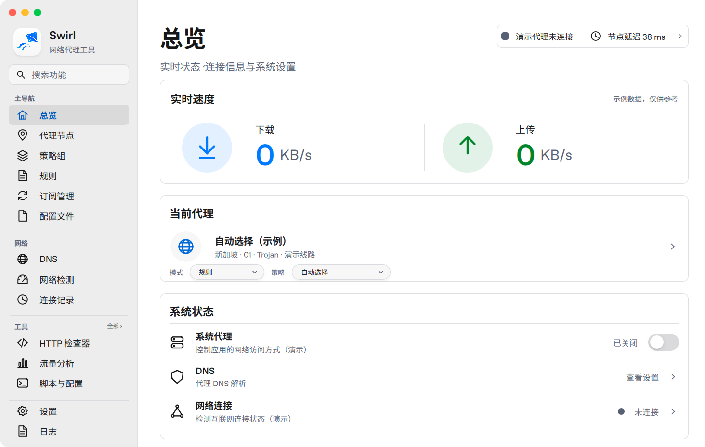
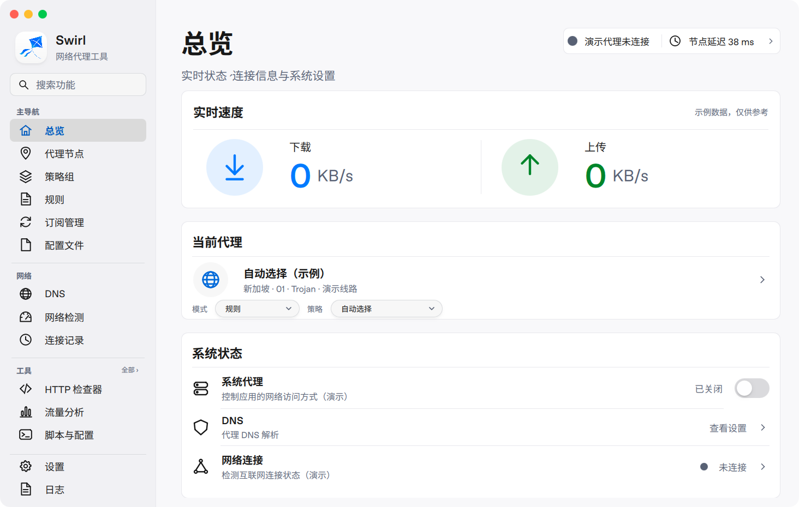
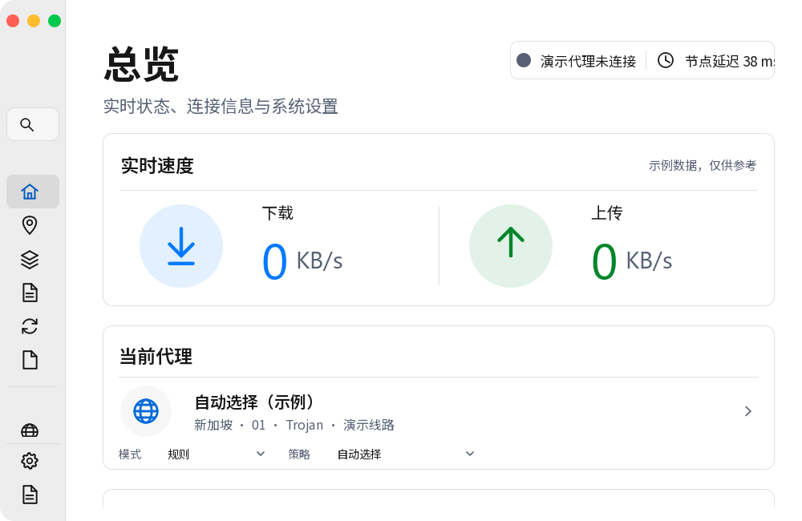
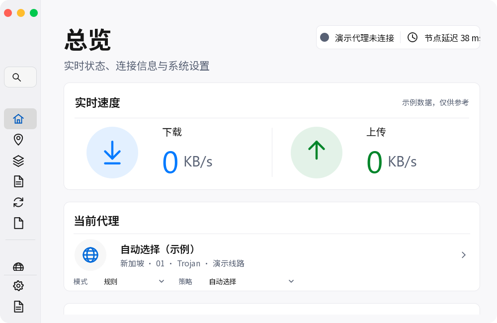

# Swirl 主内容背景层次验收

验证日期：2026-10-11（UTC）。本轮仅在 `test` 开展修改。

基线提交：`1d0ddcfff2ce29b17c3c2dafde54e947ac8a9f9d`。
实现与 Windows CI 提交：`563e38b0037fed2cae961fb403dba12d48b8fb9a`。
`main` 保持 `bfb50e1192fd39c2d84de844cdfae1605050fe46`，未向其提交、推送或合并。

## 颜色与材质

沿用现有 `Theme.qml` 语义变量，不在页面中增加颜色硬编码。

| 区域 / 变量 | 修改前（浅色） | 修改后（浅色） |
| --- | --- | --- |
| 主内容 / `canvas` | `#FFFFFF` | `#F8F8FA`，不透明 |
| 卡片 / `surface` | 与画布共用 `#FFFFFF` | 独立白色 `#FFFFFF`，不透明 |
| 侧栏 / `sidebarBase` | `#ECECEC`，透明效果开启时 alpha 0.94 | `#F1F1F4`，alpha 1 |
| 卡片边框与分隔线 / `border` | `#DEE0E4` | `#E8E8ED` |
| 窗口调色板 / `palette.window` | `Theme.surface` | `Theme.canvas` |

卡片保持现有无额外投影的实现，沿用已有边框宽度。胶囊按钮仍使用共享 `SwirlPillSurface` 和原有克制投影；未新增动画、渐变、模糊或装饰。浅色背景在透明效果开关两种状态下保持稳定，深色配色与原有透明侧栏行为保留。

窗口圆角 18、卡片圆角 12、次级与控件圆角 10、胶囊半高圆角、侧栏宽度 286 和原有响应式行为均保留。没有修改布局、卡片排列、尺寸、功能模块、中文界面文案、C++ 服务或交互测试断言。

本轮按用户提出的 Apple Music 浅色背景层次原则优化；没有新的 Apple 原始截图可做像素匹配，不声明复刻 macOS 原生材质。

## 前后截图

以下两张均从真实 QML 窗口采集，使用同一 Linux 环境、Qt 6.10.3、OpenGL/Mesa 渲染路径、相同字体和 1464×930 逻辑尺寸、DPR 1。基线从原 `test` 提交的源码快照单独构建，不修改工作分支。

修改前：

修改后：

采样位置为无文字、图标和圆角的实心区域，记录 PNG 原始 RGBA；不先合成到壁纸或白底。

| 区域 / 坐标 | 修改前 RGBA | 修改后 RGBA |
| --- | --- | --- |
| 主背景 `(300,180)` | `(255,255,255,255)` | `(248,248,250,255)` |
| 侧栏 `(200,20)` | `(236,236,236,240)` | `(241,241,244,255)` |
| 卡片 `(1200,180)` | `(255,255,255,255)` | `(255,255,255,255)` |
| 平直边框 `(600,166)` | `(222,224,228,255)` | `(232,232,237,255)` |

Windows Qt offscreen 前后对比使用同为 1000×650、DPR 1 的实际 CI 截图。修改前来自[基线 CI](https://github.com/SOLHK/Swirl/actions/runs/38121963474)，修改后来自本轮 CI；均使用该工作流的临时字体夹具。

| Windows 修改前 | Windows 修改后 |
| --- | --- |
|  |  |

这组截图的主背景、侧栏、卡片、边框 RGBA 与上表一致。最小窗口顶部状态文字的原有截断在前后截图中均存在，本轮没有改动其布局。

## 构建与测试

本地 Debian 13、GCC 14.2、C++23、Qt 6.10.3、CMake 4.4.4、Ninja：

- Release 构建通过。
- 33 项真实鼠标/键盘、节点选择、搜索、导航及草稿检查通过。
- 32 项 HTTP/CONNECT 抓包集成检查通过。
- 全页面 smoke 通过，没有 QML 加载警告或超时。
- 10 组 Qt Quick 软件预览通过，没有 Qt/QML 警告、错误或缺失截图。
- OpenGL 总览预览在 100%、125%、150%、200% 下通过，已有图标、胶囊按钮与投影可正常显示。
- 临时 QML 运行检查确认浅/深主题、透明效果开关、材质路由和原有几何参数；检查脚本仅在工作区使用，没有新增应用测试模块。

| 浅色总览缩放 | 逻辑尺寸 | 截图像素尺寸 |
| --- | --- | --- |
| 100% | 1464×930 | 1464×930 |
| 125% | 1464×930 | 1830×1163 |
| 150% | 1464×930 | 2196×1395 |
| 200% | 1464×930 | 2928×1860 |

四档缩放的实心主背景、侧栏与卡片采样颜色及 alpha 完全一致。另检查 1000×650 最小窗口、150% 最小窗口底部、1920×1219 大窗口，以及深色检查器、浅色模块目录和 DHCP 页面。最小窗口的末行“导入配置文件”仍可滚动到达。

Windows CI：

- [原有 Windows 构建](https://github.com/SOLHK/Swirl/actions/runs/38126968735) 已通过，日志确认 278 项回归与 3 项原生代理捕获检查通过。
- [Windows Qt Quick UI Preview](https://github.com/SOLHK/Swirl/actions/runs/38126968742) 全流程通过：Qt 6.10.3 / MSVC C++23 构建、输入检查、HTTP/CONNECT 集成检查、全页面 smoke、10 组预览、移除测试入口后的 Release EXE、安装包生成及产物上传。
- 已下载并核查完整构建日志、10 份逐张预览诊断和预览包。没有 Qt/QML 警告或错误；截图尺寸全部符合上表及最小/大窗口规格。
- Windows 100/125/150/200% 的主背景、侧栏及卡片采样均分别为 `(248,248,250,255)`、`(241,241,244,255)`、`(255,255,255,255)`，与 Linux 结果一致。
- 本轮测试安装包由现有 `test` 工作流生成，仅为测试版；没有执行正式版发布或 `main` 合并。

本轮强化现有 UI Preview 工作流：Qt warning/critical/fatal、缺失诊断、失败退出、缺失截图和实际像素尺寸不匹配都会使预览步骤失败；单独保留每张截图的诊断日志。

## 失败分析与修正

- 本地初始配置缺少 Qt 6.8+ SDK 与 OpenGL 开发头文件。在工作区安装 Qt 6.10.3 并提取开发依赖后重新配置、构建成功，没有降低项目版本要求。
- 全页面 smoke 成功时没有产生诊断文件。临时汇总脚本最初误将缺失文件当作错误；修正为允许无消息的成功 smoke，同时继续检查进程退出码与所有已产生的警告。
- 大窗口预览首次请求 1920×1200，实际为 1920×1219。日志与源代码确认现有 QML 高度绑定按宽度计算；改用该绑定实际产生的检查尺寸后通过，没有改动布局或窗口缩放逻辑。

## 对比度与验证范围

理论 sRGB 对比度：正文在主背景 16.90:1、在侧栏 15.90:1；次要文字在主背景 5.86:1、在侧栏 5.52:1、在白卡片 6.22:1；导航选中标签 4.62:1。现有功能性强调色与焦点令牌保留，浅色边框只承担装饰分隔作用。

Windows CI 使用真实 Windows Qt offscreen 软件渲染器和临时字体夹具，可以验证 QML 加载、交互、背景像素与 DPR。Qt Quick Effects 的 GPU 效果不能只凭软件预览验收，因此另提供 Linux OpenGL 截图。当前环境没有 Windows 原生桌面；Windows GPU/DWM 合成、多显示器切换和 OS 手势仍需真机检查，本轮没有将这些项目标为通过。

## 修改文件

- `src/Swirl.Quick/qml/Theme.qml`：复用主背景、卡片、侧栏与边框令牌。
- `src/Swirl.Quick/qml/Main.qml`：窗口调色板使用主背景令牌。
- `.github/workflows/build-qt-quick-ui.yml`：扩展尺寸/缩放预览，检查诊断与像素尺寸，保存日志。
- `src/Swirl.Quick/BUILDING.md`：更新材质说明与预览矩阵。
- `README.md`：更新浅色状态说明与截图入口。
- `docs/UI_BACKGROUND_VALIDATION.md`：本轮验收记录。
- `docs/screenshots/background-hierarchy-before.png`、`background-hierarchy-after.png`：同环境 OpenGL 前后截图。
- `docs/screenshots/background-windows-before.png`、`background-windows-after.png`：Windows Qt offscreen 前后截图。

最终归档提交仅包含文档和截图；QML、C++、构建工作流与已通过 Windows CI 的 `563e38b` 完全相同。

下一阶段和 `main` 合并均等待仓库所有者明确确认。
