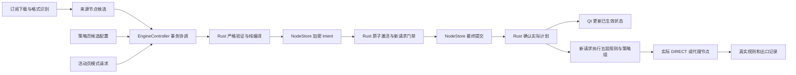

# Swirl UI V2：阶段 2 架构与实施契约

日期：2026-10-24启动（Asia/Shanghai）。设计基线 `856f11e12a20f992620597fbbddb6eab7d32929d`，产品代码仍为 `4c8c9e076976e5cfb62f103daecdf2afc121eeb3` / 0.2.3。本文件与附录描述待实施行为，不声称产品已有这些能力。当前状态：**技术方案已完成，用户在本聊天明确回答“确认这套架构”，阶段 2 已关闭，下一阶段为阶段 3**。

## 1. 用户可审阅的主要决定

1. **订阅管来源、节点管资源、策略管出口。** 节点行点击、详情、收藏和测速不改变当前出口；自动订阅刷新只更新来源节点。外部 DNS/规则/策略只能在差异预览中点击“本次应用”。
2. **国内规则与专属服务共存。** Rust 固定执行：本地及显式国内直连 → 专属海外服务 → 中国域名/IP库 → 其他自定义规则 → 默认策略。默认策略永不删除，出口可选节点或四类组；未知目标不默默 DIRECT。
3. **保存与真正生效分开。** 运行时模式/出口只在 Rust 和保存事务完成后显示成功；提交前明确失败保留旧状态。已保存删除但撤销尚未确认时显示待恢复，不能恢复已删凭据。长时间未确认显示“结果待确认”，不假装成功或擅自改成直连。
4. **旧配置先预览迁移。** 不能准确转换的规则保留原数据并解释原因；确认前继续旧语义。来源删除会移除所属节点，提示受影响策略并结束相关连接；失效出口不自动替换成首节点或 DIRECT。
5. **原生紧凑界面与既有动效继续复用。** 策略页为“服务分配｜策略组”，活动页四列原位模式菜单；窗口/侧栏统一 **14dp**，尺寸与侧栏结构保持。窗口、遮罩、阴影一起检查。
6. **能力如实显示。** 首轮 V2 接入现有系统代理链；当前 TUN、应用进程匹配不可用，相关选项标明限制并禁用。域名策略不冒充应用识别。系统代理只处理送入 Swirl 的流量。

第 6 项遵循原提示词“补齐实现或报告限制”；不把不支持的能力放进可用验收清单。真实供应商与 Codex 失败仍是交付限制，不能靠本架构文档消除。

## 2. 所有权与数据流

当前 Qt 与 Rust 是**同进程 DLL + 工作线程**，继续使用；不新增服务进程、数据库或网页框架。NodeStore 独占持久化；Rust 独占运行计划、规则判定、策略选择、DNS和真实出站；Controller 协调；QML 保存可丢弃的交互草稿。

建立三个不同层级：

| 层 | 内容 | 约束 |
|---|---|---|
| ProtectedSnapshotV2 | 来源、节点凭据、加密惰性原文、策略文档、提交回执 | NodeStore/DPAPI/QSaveFile；不暴露给 QML或公共日志。 |
| PolicyDocumentV2 | 模式、默认策略、服务、组、规则、DNS引用、固定资产版本 | 版本化的声明模型；新字段严格验证，不靠显示名关联。 |
| RuntimePlanV2 | 经验证的实际节点闭包、编译规则、策略DAG、解析器、运行身份 | Rust 不可变计划；会话保存所用 revision 和实际 leaf。 |

没有第二套“UI 模拟路由”。静态预览复用 Rust compiler/matcher，但 DNS/健康未知必须标为未知；实际连接归属只从真实会话结果读取。

## 3. 规范数据模型

wire/document 使用 `snake_case`，QML 可用等义 camelCase 属性。下列字段为公共契约；协议节点 Outbound 及既有 DNS 详细安全字段继续复用当前严格结构，不另造弱化副本。

| 对象 | 必须字段/语义 |
|---|---|
| TargetRef | 带标签 `node{id}`、`group{id}`、`direct`、`reject`、`unconfigured`。后面三项没有可伪造 id。服务表单只提供 node/group/direct；reject 保留为明确高级自定义规则。 |
| DefaultPolicy | 固定 `id=policy:default`；target 仅 node/group/unconfigured；不可删除/停用。group 的全部可达分支必须为代理，不能藏 DIRECT/REJECT。 |
| ServicePolicy | UUID `id`、name、enabled、同层唯一 priority、domains match_set、target；可选 catalog_key/version。多域名 OR；匹配方式改变不更换 ID。 |
| PolicyGroup | UUID id、name、type(manual/url_test/fallback/load_balance)、有序 members、手动 selected 或自动 health、必要 affinity。改名不重写引用。 |
| Rule | UUID id、enabled、priority、matcher、target。明确直连层与普通 custom_rules 分开；普通 DIRECT 不自动提升层级。 |
| MissingTarget | 已有目标被删除后保留 `{kind,id,safe_label,reason}`，不含凭据。原 TargetRef 的 kind/id 不变，编译时解析为明确失败。新建未知引用不允许借此绕过验证。 |
| Node/Source | 保留现有 node/source UUID 与来源语义身份算法。显示名、地区提示和节点测量均不参与中国/海外归属判定。 |

domain 为仅该域名；domain_suffix 为该域名及点边界子域，不能匹配 notexample.com。规范化 IDNA/小写/单个结尾点，非法域名拒绝；普通表单用“仅此域名／包含子域名”，不把 keyword 当 suffix。应用+网站未来定义 OR，但 capability=false 时整条组合不可启用，不能偷偷只启用域名部分。

同层 priority 数值越小越先，启用规则优先级必须唯一；前端上移/下移提交新的有序候选。完全重复匹配却指向不同出口时阻止应用，必须合并或修正匹配；部分交叠返回双方ID、见证目标、胜者及遮蔽原因，经明确审阅后可保留。不会以名字/UUID偶然顺序决定出口。

保留现有边界：目录最多 2000 节点/32 来源，活动节点闭包最多512、组128、编译规则4096，普通自定义规则产品上限1000。只编译需要运行的引用闭包；不将整个私人源文档塞入1MiB控制命令，不截断数据假装成功。上限扩大属于额外可测量改动。

[示例文件](contracts/ui-v2-policy.example.json)是无凭据、保留测试域名的设计样例，不是可导入当前产品的运行配置。其 context 提供示例 node IDs，product 不会从这个文件启动连接。

## 4. 路由、DNS、服务与组

| 模式 | 规则行为 | 最终出口 |
|---|---|---|
| rule | 固定五层顺序，本地/中国库与自定义策略共同存在 | 最终使用 defaultPolicy |
| global | 仅必要本地/安全例外；不执行服务、CN或普通自定义分流 | defaultPolicy 的实际代理 leaf |
| direct | 合法受接管目标直接连接，保留输入/自连接循环校验 | DIRECT |

`global` 的本地例外是固定本地规则集合，不包含用户所有任意显式直连目标；避免把“全局代理”变成意外的广泛直连。未知目标和分类失败走明确默认代理；强制解析的自定义阻断规则无法获得答案则失败关闭，不借分类失败绕过阻断。

分类 DNS 显式配置为禁用、直连加密 DNS或经默认代理。保持用户现有 resolver，不无声换供应商/路径；代理模式绕过业务路由器直达已验证默认 leaf，resolver 用固定 bootstrap 地址并验证TLS名称，代理服务器解析使用独立bootstrap配置，健康检测也不能依赖尚未选出的自动组。禁止隐式系统/明文降级。

多 A/AAAA 答案按同一不可变集合判定实际拨号地址；其他答案不能证明当前地址应 DIRECT。重试只允许同规则/策略链/leaf的地址，不跨直连与代理竞速。没有可靠分类证据时保守走默认，并在诊断显示“未完成分类”；不宣称完整识别所有国内流量。

服务目录固定版本/哈希、保留第一方来源及核实时间。Google 与 YouTube 有明确排除集合；OpenAI 与 Claude 分开。共享登录/CDN只能按已知目标域处理，不能从浏览器页面上下文猜归属；未知依赖仍默认。目录变更也需展示差异，不能热更新后悄悄扩大捕获。

四类组复用现有核心，全类型嵌套按有界 DAG 解析，保留每层策略。深度≤16、自动组≤32、自动成员≤64、展开后的不同 leaf/healthProfile 探测任务≤512、并发4；手动组成员仍可到512，实际活动闭包仍受512节点限制。所有分支均检查循环，不能只查当前选择分支。

自动组先接收祖先健康约束并与本组profile求交，再递归执行子组策略，避免先选A后求交却漏掉可用B；manual仍严格selected。探测结果绑定叶节点配置/检测参数/revision，不能用A的结果批准B。父自动测速对子分支采用保守的最慢有效叶耗时。服务粘性使用稳定 policy/service/group ID，跨该服务的域名保持同出口；两个不同服务仅指向同一负载均衡组不保证同leaf。默认未分类流量使用保守公共桶，不猜跨域App身份。没有健康候选报错，不擅自 DIRECT、不重放已经发送的业务请求。

新自动组启用时健康未知，界面显示“等待检测”，不先用未测节点；探测超时继续不可用。普通策略/模式切换只影响新流，已有隧道保留快照；来源删除属于撤销，成功确认前必须停止相关会话、探测和连接池。

完整解析、嵌套及迁移细节见 [路由契约](UI_V2_STAGE2_ROUTING.md)。

## 5. 保存、应用、失败恢复和迁移

沿用 C buffer ABI v1，新增控制协议 v2及 capabilities，不把 C ABI数字和文档schema混为一谈。既有入口不能绕过V2 handle的revision/CAS；版本或能力不符明确拒绝，不能降级回旧语义。

每个请求绑定 request_id、store_id、engine_epoch、base_saved_revision、expected_generation。u64跨JSON/QML全部用规范十进制字符串；Rust prepare返回候选digest/token，Qt原样保留，不实现另一套摘要算法。实际snapshot增加 applied_revision、digest、mode及事务状态。

在线提交：**纯prepare → 加密pending intent → 新请求门禁 → CAS activate → 最终QSaveFile → Rust finish及真实回执 → 更新UI**。只有一个在途修改；不同request_id的并发修改返回Busy，同ID重试查询既有结果。浏览、页面动画和网络旧会话不因编辑器忙碌冻结。

prepare不探测/拨号；门禁只在最终提交窗口限制新逻辑流，不持Plan锁跨磁盘I/O。门禁初始上限2秒/64等待流；超时仍未拿到磁盘结果时保持门禁并显示reconciling，不能盲回滚可能已落盘的提交。明确写失败才恢复旧内容并核对；恢复失败拒绝新流，不能走当前会自动disable系统代理的普通Failed路径。

最终commit成功但ACK丢失，通过request/revision/digest恢复同一结果，不二次切换。崩溃后读取唯一committed；pending撤销不得以旧凭据自连。离线保存显示“下次连接应用”，applied_revision=null，不显示网络已切换。QSettings仅存UI偏好，模式/默认出口/手动组选择迁入同一加密权威文件。

订阅刷新只做nodes-only事务；来源定义或目录版本变化时重验候选，晚到下载不可重建已删来源。完整配置确认ticket绑定源字节摘要、source版本、候选digest、saved revision、能力和本次会话；一次性、10分钟、仅内存。定时刷新不接受ticket，重启/新下载/基线变化需要新预览。

schema1先保留原语义LegacyOrdered；新ID映射持久化，歧义名称不猜。迁移预览必须列明CN重新启用、层级变化、默认proxy-only、全局本地例外、DNS路径、轮询改服务粘性及不支持项；确认后再原子启用V2。默认未配置可作为草稿存在；首次rule/global启动须有合法默认。运行中来源删除可令默认不可用，此时只阻断需要该默认出口的流量。

删除来源移除当前库及应用管理缓存中的来源/节点凭据。保持无凭据tombstone使引用可解释；手动组失效不选首项，自动组仅按已配置算法使用剩余候选。普通组被手动删除时先要求修正引用；来源/节点撤销不能因引用而被永久阻止。用户自行保存的外部备份不自动处理，也不声称物理安全擦除。

事务状态机、撤销屏障、错误及崩溃矩阵见 [接口契约](UI_V2_STAGE2_API.md)。

## 6. Qt/QML 页面与动效

- 节点：沿用ProxiesPage路由，NodeViewModel筛选/排序 + NodeSectionModel虚拟来源标题，一个ListView。来源内排序，搜索时临时展开命中来源，清空恢复折叠；以稳定displayKey保存焦点和滚动，不用index×固定行高估算。列表仅纯浏览/测量/收藏。
- 策略：服务分配默认行固定，独立策略组标签；共用PolicyTargetPicker提交typed ID。健康检测、超时、间隔和切换参数折叠。没有永久右侧详情和大节点卡片。
- 订阅：紧凑来源行显示成功节点数/时间和更新状态；请求格式兼容选项放高级区。commit前失败保留旧数据，删除要等finish/撤销ACK后播放退出；commit后撤销待恢复显示只读占位，不能还原已删凭据。
- 活动：保留“网络／配置／出站模式／外部IP”，原位文本菜单读appliedMode；pending时显示目标和进度，失败仍显示旧模式。
- 复用SwirlMotion的80/140ms按压释放、190ms导航、220ms选择/弹窗、160ms退出；菜单补触发点位移/缩放，排序只处理可见行残差。语义结果不等待动画结束，反向从当前视觉值接续；pooled/离屏停动画、复用清理节点状态。
- 14dp使用统一逻辑值，覆盖Theme、Main、Sidebar、HWND回退区域、WindowEdge/shadow shader；保持曲线、抗锯齿、尺寸和缓存，最大化/全屏仍矩形。修改聚焦几何断言，不整体重录旧hash来掩盖变动。

UI采用Qt 6.10可用的列表复用和模型通知机制，模型修改留在其所属线程，重数据预处理可用worker。[Qt 6.10 ListView](https://doc.qt.io/qt-6.10/qml-qtquick-listview.html)、[QAbstractItemModel](https://doc.qt.io/qt-6/qabstractitemmodel.html#beginMoveRows)

目标是常见暖场景P95帧间隔≤16.67ms、P99≤33.3ms、输入反馈≤100ms，并完整报告长帧/场景/刷新率；这些是目标不是成绩。真实目录100/500/2000节点，5000只可作为超出当前产品上限的合成模型探索，不代表支持导入5000节点。卡顿用QML Profiler定位，不能删动画或一律淡入淡出来换数字。

文案、组件API、快捷键、状态、14dp消费链和文件拆分见 [UI实施契约](UI_V2_STAGE2_UI.md)。

## 7. 开发顺序与验收闸门

| 阶段 | 实施内容与依赖 | 必要验证 |
|---|---|---|
| 3 | 节点资源库、来源分区、搜索/筛选/测量/收藏及过渡；旧策略页继续承接选出口，防止功能真空 | 行点击/键盘/详情零出口变更；复用/取消/增量更新；真实Rust测量；受影响表格回归。 |
| 4 前置 | 将自动订阅导入固定节点事务，关闭未经确认覆盖的后端入口；UI仍可保留旧来源页 | 当前规则/DNS/组不被刷新改变，失败保留，严格字段与协议验证仍在。 |
| 4 | V2模型、迁移、事务、五层路由、服务和所有组类型、真正默认策略及观测链 | 独立受控出口证明DIRECT/默认/专属真实流向；事务故障注入；DAG/健康/粘性/删除撤销；域名/IP/DNS双栈。 |
| 5 | 订阅来源页与完整配置差异/一次性确认 | 更新时间只随成功提交；过期下载、来源删除、确认失效与重启不复用授权。 |
| 6 | 活动模式入口、14dp、菜单/弹窗/列表统一动效与性能 | 已应用确认/失败恢复/忙态；聚焦几何与反向动画；同机前后帧时间，保留未达目标。 |
| 7 | 当前实现SHA的Windows包与人工教程 | 必要核心/代理恢复/包完整性检查；CI全回归并行；EXE/DLL/manifest同SHA，人工实际服务和DPI边界单列。 |

最小反例与验收编号保存在 [验收映射](contracts/ui-v2-acceptance-cases.json)；全部标为planned，实施阶段才能产生通过证据。控件截图不能证明流量出口，受控peers也不能替代私人供应商/Codex验收。

阶段2只做文档、示例与验收契约检查，产品版本不递增、不重建旧安装包。当前0.2.3真实联网未解决，后续若仍存在严重网络问题，只能交付明确诊断包，不称普通可用测试版。独立构建目录不得重配其他窗口CMake缓存。

## 8. 决策依据与阶段状态

继续使用已读四大Skills：Hallmark用于已有品牌/壳层内的信息布局；UI UX用于虚拟列表、焦点和错误反馈；Motion用于有意义且可打断的空间过渡；Qt用于模型通知、对象生命周期和原生组件。没有引入网页框架、装饰性常驻动画或重复安装技能。

沿用QSaveFile的临时写入/提交模型，并保留direct-write fallback关闭；未知JSON字段继续严格拒绝。[Qt QSaveFile](https://doc.qt.io/qt-6/qsavefile.html)、[Serde container attributes](https://serde.rs/container-attrs.html)

本阶段已完成两路交叉评审，修正了嵌套健康约束顺序、同组不等于同出口、提交后撤销失败和自动组冷启动等契约问题。已运行7项portable guard；4份架构文档内部链接、示例5个UUID及引用图、40项验收映射覆盖19组需求的静态一致性检查通过。后者只验证设计资料，**40项产品用例均未执行**，没有性能或真实联网通过结论。

设计提交为 `b54742f585cecf1620091052298248a7d7f03b31`。用户审阅后明确确认了五层路由、默认策略、订阅/节点职责、策略双标签、生效确认、14dp及当前TUN/应用匹配限制。此确认记录随下一笔文档提交保存；所有新增V2运行行为、回滚机制、14dp及性能目标仍尚未实现。

**阶段 2 完成，建议切换 GPT-6.1 Sol Ultra 开始实际开发。** 下一阶段为节点资源库开发；本次未自动切换模型。
